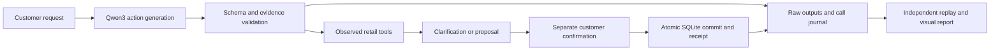

# ResolveDesk

**An English retail service agent with Qwen3, customer-confirmed transactions, and auditable LoRA experiments.**

ResolveDesk handles simulated order lookup, returns, exchanges, missing contact details, stockout fallback and human handoff. It combines a FastAPI/SQLite application, local Ollama integration, separate adapter serving, bounded tool calls and a read-only evaluation workspace. Orders, customers, payments and transactions are synthetic.

[中文介绍](docs/project.zh-CN.md) · [Completed experiment report](docs/cuda-evaluation2.md) · [中文评测报告](docs/cuda-evaluation2.zh-CN.md) · [Per-case results](docs/figures/cuda-eval2/per-case.csv) · [Publication status](PUBLICATION_STATUS.md)

## What I built

- **Stateful tool workflow:** validated request extraction, order/product lookup, clarification state, inventory checks and scenario-specific handoff. Every rejected or corrective model action consumes the same task budget.
- **Transaction handling:** proposals require separate customer confirmation. SQLite revision checks, atomic commits and idempotent receipts handle repeated confirmation without duplicating a simulated transaction.
- **Consent and recovery instrumentation:** separate raw first-output interpretation from later accepted records; audit attempts, proposals, commits and final state independently. Preserve exact evidence quotations, schema errors, duplicate calls and all failures.
- **Actual model adaptation:** continue an existing Qwen3-4B adapter using deduplicated SFT data, field-weighted completion loss and a fixed final CUDA checkpoint. Keep local MLX and CUDA experiments separate.
- **Reproducible evaluation:** fresh synthetic order worlds, fixed comparison arms, captured input/output token IDs, call journals, independent CPU replay and six groups of source-backed PNG/SVG charts.



## Completed before/after experiment

**Independent CUDA evaluation run002 is complete: 48 fresh authored synthetic tasks, 96 matched arm/task records and 509 completed model calls.** Both arms use the same FP16 base, V7 workflow, tokenizer, greedy decoding and 12-total-call limit. The comparator is an **already fine-tuned V6.1 predecessor**, followed by its fixed 1,344-update continuation.

| Metric | Predecessor | CUDA continuation | Interpretation |
| --- | ---: | ---: | --- |
| All seven first-output fields correct | 31/48 (64.6%) | 39/48 (81.3%) | +16.7 percentage points |
| Unsupported initial fallback-consent YES ↓ | 12/36 (33.3%) | 3/36 (8.3%) | 75% fewer false affirmative predictions |
| Complete business tasks | 46/48 (95.8%) | 45/48 (93.8%) | **Decreased 2.1 percentage points** |
| Available exchanges | 14/14 | 14/14 | Retained |
| Necessary handoffs | 16/16 | 16/16 | Retained |
| Missing-email resolution | 8/8 | 8/8 | Retained |
| Authorized stockout fallback | 3/4 | 2/4 | Regressed |
| Repeated field questions | 0 | 0 | Retained |
| Identical-action repeats ↓ | 0 | 11 | New quote-validation loop |

**Better extraction did not improve overall task success.** Paired outcomes were 45 shared passes, two shared failures and one regression; no task improved. The 75% reduction concerns unsupported **initial predictions**, not actual unauthorized transactions or production outcomes. This small, self-authored cohort shares policy/family structure with development and uses a narrow rain-jacket catalog. It is not an official τ-bench score or real customer study.

The CUDA training actually completed **1,344 optimizer updates** on **824 deduplicated SFT pairs from 96 source scenarios**. Rank-8 adapters in the last eight layers update **3,670,016 parameters across 112 tensors**. Independent CPU reads verified exact predecessor initialization and finite changed final weights. The CUDA path uses a decoded-4bit-derived **FP16 frozen base and FP32 adapter parameters**; it is not an NF4 QLoRA run. Loss weights are 8 for fallback-consent values and 4 for reason values. The final checkpoint was fixed before this evaluation.

## Visual evidence


| Chart group | Inspectable formats |
| --- | --- |
| Business outcomes | [PNG](docs/figures/cuda-eval2/evaluation.png) · [SVG](docs/figures/cuda-eval2/evaluation.svg) |
| Initial interpretation | [PNG](docs/figures/cuda-eval2/intent.png) · [SVG](docs/figures/cuda-eval2/intent.svg) |
| Recovery, repeats and calls | [PNG](docs/figures/cuda-eval2/recovery.png) · [SVG](docs/figures/cuda-eval2/recovery.svg) |
| All 24 scenario families | [PNG](docs/figures/cuda-eval2/families.png) · [SVG](docs/figures/cuda-eval2/families.svg) |
| Scoped consent audit | [PNG](docs/figures/cuda-eval2/consent.png) · [SVG](docs/figures/cuda-eval2/consent.svg) |
| Actual training trace | [PNG](docs/figures/cuda-eval2/training.png) · [SVG](docs/figures/cuda-eval2/training.svg) |

[Chart values](docs/figures/cuda-eval2/values.json) and [per-case CSV](docs/figures/cuda-eval2/per-case.csv) retain exact denominators. Large scientific JSON/JSONL files are losslessly compressed; the unpack script verifies their public SHA256 before restoring the paths consumed by the application and audits.

## Run locally

Requires Python 3.12 and [uv](https://docs.astral.sh/uv/). Ollama is optional for inspecting the report; live conversations require a configured model endpoint.

```bash
git clone https://github.com/xvbohan92-ai/resolvedesk-retail-agent.git
cd resolvedesk-retail-agent
python3 scripts/unpack_evidence.py
uv sync --frozen
uv run resolvedesk serve --port 8771
```

Open `http://127.0.0.1:8771/`. For local Ollama, provision `qwen3:4b`, run `uv run python -m training.setup_ollama` to create the checked `resolvedesk-qwen3:4b` decoding profile, and select Ollama in the app. The setup script validates the installed template and refuses unfamiliar versions; it does not fine-tune weights. See [.env.example](.env.example) and the [CLI](resolve_desk/cli.py) for configuration. Training weights, databases and credentials are excluded. The CUDA report remains inspectable without loading a model; reproducing inference additionally requires the pinned base and matching adapters.

```bash
uv sync --frozen --group viz
uv run ruff check resolve_desk training tests scripts --exclude "*.ipynb"
uv run pytest -q
uv run python scripts/reconcile_public_results.py --output /tmp/resolvedesk-public-reconciliation.json
```

The default public CPU suite covers the API, workflow, confirmation/transaction boundaries and the resolution controllers. Historical archive/seal and operator-receipt tests remain in source but require the original local archive and are outside this public CI scope. Model inference and optional GPU/MLX checks require separately provisioned runtimes. Public reports are redacted scientific projections: their new hashes are recorded separately, and the original local byte seal does not certify the redacted files.

The completed run002 was verified locally with **403 tests passed and 8 skipped**, token/event replay and reconciled charts. This records that completed experiment's validation, not a claim that every optional GPU/MLX check runs in GitHub CI. Public-export verification is recorded separately in `public-validation.json`.

## Current limitations and V8 work

Three retained run002 failures motivate the next iteration: an invalid evidence quotation caused a repeated-call loop; payment wording skipped a required clarification; and a noncanonical catalog description caused an unnecessary handoff. The frozen V7 controller also retains a known operation-rewrite path that can bypass the intended exchange-fallback consent gate. Zero observed unconsented commits in this narrow audit does not establish production safety.

**V8 is unfinished.** Its repair code, training data and three-arm evaluation plan are prepared. The four-update GPU smoke test completed, but formal training failed at zero updates before model loading because the launcher passed a relative smoke-report path. No V8 model-quality result or completed three-arm evaluation is claimed. Recovery work remains separate from this public snapshot. See [V8 plan](docs/round-8-plan.md) and [publication status](PUBLICATION_STATUS.md).

The earlier interrupted 84/96 evaluation is archived separately and is never pooled with completed run002. Historical rounds remain under `training/v*`, `reports/v*` and `docs/round-*`; their different test sets and runtimes are not interchangeable.

## Attribution

Retail policy is adapted from [Sierra Research tau2-bench v2.0.0](https://github.com/sierra-research/tau2-bench/tree/989d3285ae669e49503324bdb9981bf14fccedeb), pinned commit `989d3285ae669e49503324bdb9981bf14fccedeb`. The original policy and MIT license are retained in [third_party/tau-bench](third_party/tau-bench/README.md). ResolveDesk's limited tools, controller, synthetic datasets, training and grader are project implementations. Qwen model materials retain their original Apache-2.0 terms. No official benchmark affiliation or score is claimed.
