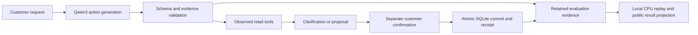

# ResolveDesk

**A Qwen3 retail service agent with validated tools, customer-confirmed transactions, and measured LoRA experiments.**

ResolveDesk handles simulated order lookup, returns, exchanges, missing contact details, stockout fallback and human handoff. I built the FastAPI/SQLite workflow, local Ollama integration, transaction boundaries, training experiments and evidence-based evaluation. Customers, orders, payments and transactions are synthetic.

[中文介绍](docs/project.zh-CN.md) · [Latest stage report](docs/v8-eval2-partial40.md) · [阶段性中文报告](docs/v8-eval2-partial40.zh-CN.md) · [Failure analysis](docs/v8-eval2-partial40-failure-analysis.md) · [Public result summary](reports/v8-eval2-partial40/public-summary.json) · [Publication status](PUBLICATION_STATUS.md)

## Latest: completed V8 training, partial three-arm evaluation

**The saved V8 continuation completed 1,344 optimizer updates. Its later three-arm evaluation stopped at the fixed deadline with 136/144 complete task records: 48, 48 and 40 by arm.** Seven tasks were unstarted; one has an issued call without a retained response and must not be replayed. Those eight missing complete records are neither model successes nor failures; the original 144-record experiment remains incomplete.

A separately authorized, **retrospective common-prefix analysis** compares the same first **40 cases × 3 arms = 120 complete traces and 657 model calls**. It uses retained evidence only, with no generation, training or validation rerun. The comparator was already fine-tuned.

| Metric on the same 40 cases | Prior weights / V7 flow | Prior weights / V8 flow | Saved V8 weights / V8 flow |
| --- | ---: | ---: | ---: |
| Correct business handling | 30/40 (75.0%) | 30/40 (75.0%) | 33/40 (82.5%) |
| Available-exchange subset | 5/10 | 7/10 | 8/10 |
| Stockout-fallback subset | 1/2 | 2/2 | 2/2 |
| Necessary handoff | 13/16 | 10/16 | 13/16 |
| Missing-email subset | 2/4 | 2/4 | 3/4 |
| All seven first-output fields correct | 24/40 | 24/40 | 27/40 |
| Unsupported initial fallback-consent YES ↓ | 1/32 | 1/32 | 1/32 |
| Identical-action repeats ↓ | 48 | 15 | 9 |
| Unnecessary handoffs executed ↓ | 5 | 0 | 0 |
| Model calls | 236 | 208 | 213 |

Correct business handling includes a correct proposal followed by the customer's **approval or decline**. These exchange/fallback counts are not counts of executed exchanges or refunds. First-output fields are scored before repair; an unsupported initial YES prediction is not itself an unauthorized transaction.

With **V8 flow fixed**, the saved training continuation adds **3 correctly handled cases / 7.5 percentage points** on this subset: **5 cases improve and 2 regress**. The training bundle includes data, sampling and loss choices; this is not an ablation of any one component. With **prior weights fixed**, changing V7 to V8 flow leaves overall handling at 30/40, with five improvements and five regressions.

**The remaining regressions matter.** Under the same V8 flow, initial payment-field accuracy falls from **39/40 to 37/40**, model calls rise from **208 to 213**, and unsupported initial YES remains **1/32**. Both arms deliver zero repeated field questions, while repeated actions persist. All 27 failed arm/task records remain in the selected CSV. The saved V8 adapter still fails seven selected cases; [the failure analysis](docs/v8-eval2-partial40-failure-analysis.md) retains quote-validation loops, invalid clarification fields, stale evidence after customer replies and conservative controller checks.

### What this subset cannot establish

The deadline and fixed serial arm/case order leave **20 of 24 families** in the common prefix. Omitted branches are available exchange with explicit return refusal, stockout fallback with missing payment, available exchange with missing email, and combined missing-email/payment recovery. These include important V8 repair targets, so this result does **not** show that all V8 fixes work.

All 16 necessary-handoff cases remain, but eight non-handoff cases are missing: case mix changes from 16/48 to 16/40 handoff cases. This is **nonrandom truncation**, not a new external benchmark. Do not extrapolate the rates to all 48 cases or compare the overall rate directly with earlier experiments on different cohorts. Same-author synthetic worlds, finite catalogs and scripted replies further limit generalization. Zero observed scoped-consent violations on the selected paths does not certify production safety.

## Latest visual evidence


| Chart group | Inspectable formats |
| --- | --- |
| Business handling | [PNG](docs/figures/v8-eval2-partial40/evaluation.png) · [SVG](docs/figures/v8-eval2-partial40/evaluation.svg) |
| Raw first-output fields | [PNG](docs/figures/v8-eval2-partial40/intent.png) · [SVG](docs/figures/v8-eval2-partial40/intent.svg) |
| Recovery, repeated actions and clarifications | [PNG](docs/figures/v8-eval2-partial40/recovery.png) · [SVG](docs/figures/v8-eval2-partial40/recovery.svg) |
| Family outcomes and four excluded families | [PNG](docs/figures/v8-eval2-partial40/families.png) · [SVG](docs/figures/v8-eval2-partial40/families.svg) |
| Separate consent attempts, proposals and commits | [PNG](docs/figures/v8-eval2-partial40/consent.png) · [SVG](docs/figures/v8-eval2-partial40/consent.svg) |
| Historical V8 training and descriptive task timing | [PNG](docs/figures/v8-eval2-partial40/training.png) · [SVG](docs/figures/v8-eval2-partial40/training.svg) |

[Per-case CSV: 120 selected traces](docs/figures/v8-eval2-partial40/per-case.csv) · [40-case paired mapping](docs/figures/v8-eval2-partial40/case-mapping.csv) · [Metric denominators](docs/figures/v8-eval2-partial40/metrics.csv) · [Historical training CSV](docs/figures/v8-eval2-partial40/training.csv)

The training plot is the **already completed** V8 run, not new training in this evaluation. The saved continuation used rank-8 adapters in the last eight layers: **112 FP32 tensors / 3,670,016 trainable parameters**. Its 1,344-update schedule sampled **888 of 1,100 unique SFT pairs from 96 source scenarios**. The base is frozen FP16 derived from a decoded 4-bit checkpoint; this is not NF4 QLoRA. Serial latency includes arm order, prompt/trajectory differences and logging, so it is not an isolated hardware-speed comparison.

## What I implemented

- **Stateful tool workflow:** request extraction, schema/evidence checks, order/product lookup, clarification memory, inventory checks and policy-specific handoff. Failed and corrective actions share a 12-total-call task budget.
- **Transaction boundaries:** a proposal requires separate customer confirmation. SQLite revision checks, atomic commits and idempotent receipts prevent duplicate simulated transactions on repeated confirmation.
- **Recovery and consent instrumentation:** preserve first raw predictions and later repairs separately. Count raw attempts, proposals, commits and final orders as different units; retain invalid fields, duplicate actions and every failed case.
- **Training and comparisons:** deduplicated SFT pairs, field-weighted completion loss, exact saved-adapter initialization checks and a fixed final checkpoint. Three arms separate workflow changes from the training bundle under fixed flow.
- **Inspectable results:** captured token/tool evidence was independently replayed locally; published summaries, per-case CSVs, failure analysis and PNG/SVG figures expose the result and its limitations.



## Historical complete experiment: independent CUDA run002

This is a **different, earlier cohort**, retained separately: **48 authored synthetic cases, 96 matched arm/task records and 509 completed calls**. Both arms used the same FP16 base, V7 workflow, greedy decoding and 12-call limit. The comparator was an already fine-tuned V6.1 predecessor.

| Historical run002 metric | Predecessor | CUDA continuation |
| --- | ---: | ---: |
| Joint first-output fields | 31/48 (64.6%) | 39/48 (81.3%) |
| Unsupported initial fallback-consent YES ↓ | 12/36 | 3/36 |
| Correct business handling | 46/48 (95.8%) | 45/48 (93.8%) |
| Stockout fallback | 3/4 | 2/4 |
| Identical-action repeats | 0 | 11 |

Extraction improved, but overall business handling **regressed**: no paired case improved and one regressed. That continuation completed 1,344 updates on 824 deduplicated SFT pairs from 96 source scenarios. It is not the latest V8 training or the common40 cohort. The earlier interrupted 84/96 run and the later V8 partial evaluations also remain separate; none are pooled.

[Historical English report](docs/cuda-evaluation2.md) · [历史中文报告](docs/cuda-evaluation2.zh-CN.md) · [Historical CSV](docs/figures/cuda-eval2/per-case.csv)

## Run locally

Requires Python 3.12 and [uv](https://docs.astral.sh/uv/). A model endpoint is optional for reading the static reports; live conversations require a configured endpoint.

```bash
git clone https://github.com/xvbohan92-ai/resolvedesk-retail-agent.git
cd resolvedesk-retail-agent
python3 scripts/unpack_evidence.py
uv sync --frozen
uv run resolvedesk serve --port 8771
```

Open `http://127.0.0.1:8771/` for the retail demo and historical evaluation workspace. The latest V8 stage results are available in the linked Markdown reports and image/CSV files. For the public read-only stage viewer, run `uv run python -m resolve_desk.public_partial40 --port 8774` and open `http://127.0.0.1:8774/`; this reads published CSVs and figure hashes without private logs or a model. This command does not activate the saved V8 adapter. For Ollama, provision `qwen3:4b`, then run `uv run python -m training.setup_ollama` to create the checked `resolvedesk-qwen3:4b` profile. See [.env.example](.env.example) and the [CLI](resolve_desk/cli.py). That setup validates the installed template; it does not fine-tune weights.

[The latest public reconciliation script](scripts/reconcile_partial40_public_results.py) checks the published numerical projection. Existing application checks remain available:

```bash
uv sync --frozen --group viz
uv run ruff check resolve_desk training tests scripts --exclude "*.ipynb"
uv run pytest -q
uv run python scripts/reconcile_partial40_public_results.py
uv run python scripts/reconcile_public_results.py --output /tmp/resolvedesk-public-reconciliation.json
```

Public CI covers the application/workflow/transaction contracts and the published checks configured for this export. Private archive/seal tests and optional inference/GPU/MLX checks require their original evidence or separately provisioned runtimes. The historical run002 validation of 403 passed / 8 skipped is that experiment's local record, not a claim that every optional test runs in GitHub CI.

## Evidence and publication scope

The latest local CPU audit covered **all 136 complete records and 765 retained responses**, plus the unknown call's request without reconstructing its response or business effects. Only the selected 120 records contribute to the common40 comparison.

**This V8 public update contains a sanitized result summary, derived CSVs, figures and failure analysis. It excludes the V8 raw trajectories, token arrays, call journals, weights, databases, account/resource approvals, operator records and cloud snapshots.** It supports inspection and numerical reconciliation of the public projection; it does not let a reader reproduce the private token/event replay. Public projections have their own hashes and do not inherit the original local byte seal. Previously published historical synthetic evidence remains under its own experiment paths.

The initial V8 launcher failure at zero formal updates was a real bootstrap failure. It was followed by a completed 1,344-update training run; it is not the current training status. Current results still leave quote repair, payment interpretation, clarification-field selection and omitted consent/recovery branches unresolved. No production deployment or default-provider promotion is claimed.

## Attribution

Retail policy is adapted from [Sierra Research tau2-bench v2.0.0](https://github.com/sierra-research/tau2-bench/tree/989d3285ae669e49503324bdb9981bf14fccedeb), pinned commit `989d3285ae669e49503324bdb9981bf14fccedeb`. The policy and MIT license are retained in [third_party/tau-bench](third_party/tau-bench/README.md). ResolveDesk's limited tools, controllers, synthetic datasets, training and grader are project implementations. Qwen materials retain their original Apache-2.0 terms. No official benchmark affiliation or score is claimed.
