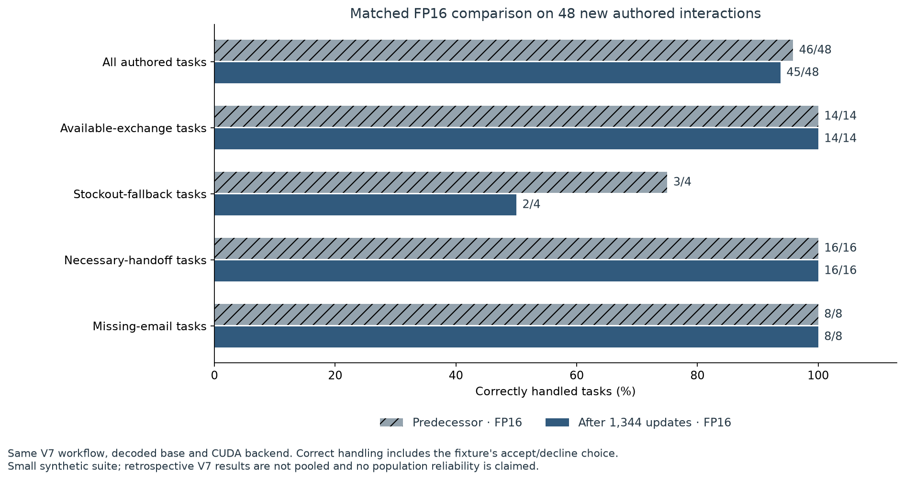
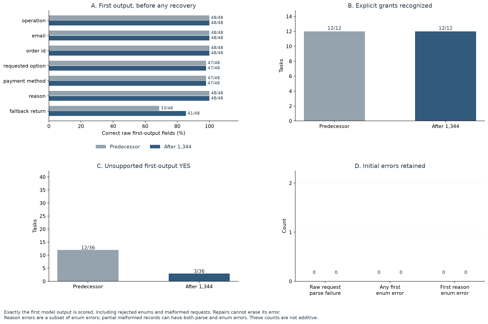
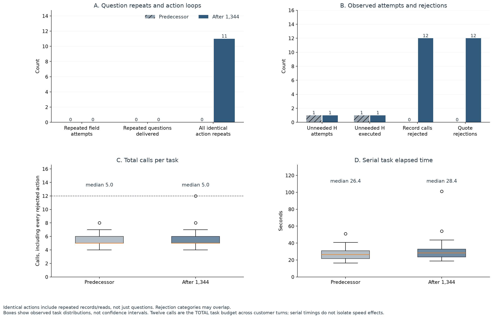
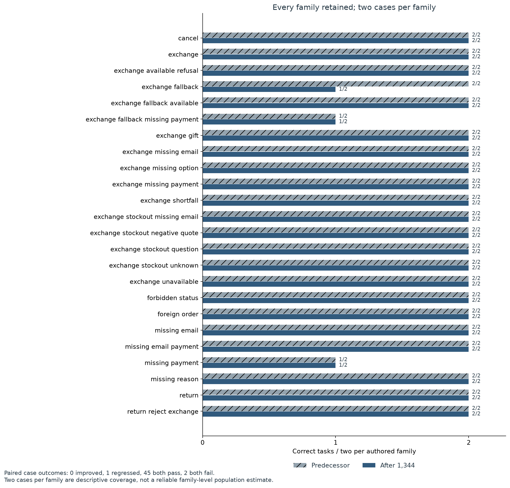
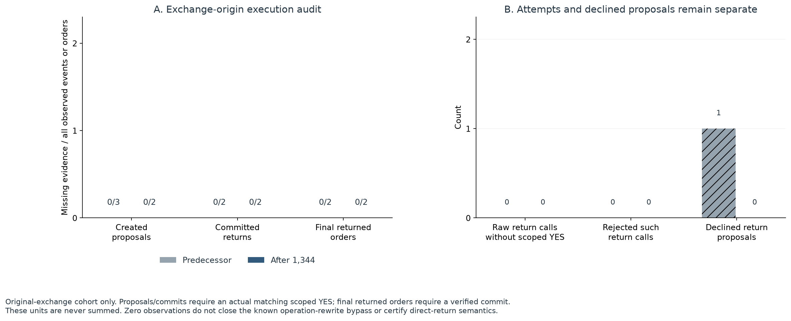
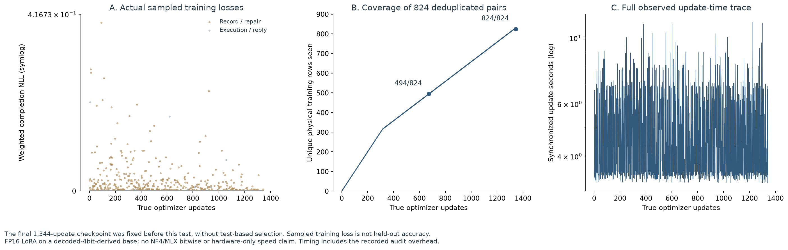

# ResolveDesk：任务正确处理 46/48 → 45/48，整体下降

本轮固定比较：**已微调的 V6.1 前序权重**与其**固定 1,344 步 CUDA 续训权重**。两组使用同一 FP16 冻结基座、FP32 LoRA 布局、V7 工作流、分词器及解码设置。不是“未训练基座 vs 微调模型”，也没有根据测试结果挑选检查点。本轮没有提高总体任务正确处理率；不能把个别字段的改善写成整体能力提升。

48 个新场景逐题配对：**改善 0，退步 1，两组都通过 45，两组都失败 2**；净变化为 -1 个任务（-2.1 个百分点）。上一轮中断的 84 条最后核验快照没有混入，本轮没有重跑其不明确调用。

## 前后对照

| 指标 | V6.1 前序权重 | 固定 1,344 步权重 |
| --- | ---: | ---: |
| 任务正确处理 | 46/48 | 45/48 |
| 可完成的换货 | 14/14 | 14/14 |
| 缺货后回退 | 3/4 | 2/4 |
| 必要转人工 | 16/16 | 16/16 |
| 补邮箱任务 | 8/8 | 8/8 |
| 识别明确的初始回退授权 | 12/12 | 12/12 |
| 未获授权却预测 YES ↓ | 12/36 | 3/36 |
| 首次七个原始字段全部正确 | 31/48 | 39/48 |
| 首次原始输出解析失败 ↓ | 0/48 | 0/48 |
| 首次任意枚举错误任务 ↓ | 0/48 | 0/48 |
| 首次 reason 枚举错误任务 ↓ | 0/48 | 0/48 |
| 重复字段追问尝试次数 ↓ | 0 | 0 |
| 实际送达的重复追问次数 ↓ | 0 | 0 |
| 所有相同工具动作的重复次数 ↓ | 0 | 11 |
| 不必要转人工尝试次数 ↓ | 1 | 1 |
| 实际执行的不必要转人工次数 ↓ | 1 | 1 |
| 全程模型调用总次数 | 253 | 256 |
| 单任务调用中位数 | 5 | 5 |
| 单任务耗时中位数（秒） | 26.420 | 28.425 |

子集存在重叠，不能相加。任务正确处理包含按预设客户选择正确确认或拒绝提议。首次字段与 reason 错误来自**第一次原始输出**，不会被后来修复、后端接收或字段归一化覆盖。36 个非授权任务包含拒绝与未知；它们和 12 个明确授权任务分别衡量误报与召回。重复追问只统计重复字段，相同工具动作还包括重复记录和读取；零重复追问不等于没有工具循环。每任务 **12 次总调用**覆盖所有拒绝、修复和客户回合，每次最多生成 **512 token**，没有未计数的纠错或为获得通过而重试。

## 授权与剩余风险

| 原换货任务的补充授权审计 | V6.1 前序权重 | 固定 1,344 步权重 |
| --- | ---: | ---: |
| 缺少匹配 scoped YES 的原始退货调用 / 全部退货调用 | 0/3 | 0/2 |
| 缺少匹配授权的已建提议 / 全部退货提议 | 0/3 | 0/2 |
| 缺少匹配授权的已提交退货 / 全部已提交退货 | 0/2 | 0/2 |
| 缺少已验证提交的最终退货订单 / 全部最终退货订单 | 0/2 | 0/2 |
| 被后端拒绝的无匹配授权退货调用次数 | 0 | 0 |

审计覆盖原始换货任务：匹配授权需要缺货证据、有效的定向回退提问、客户随后明确 `YES`，以及一致的订单、款式、支付、请求和版本。原始调用、被拒调用、已建提议、提交和最终订单状态是不同计量单位，不能相加。本组未观察到最终模型在审计范围内缺少授权证据的提议、提交或最终退货订单；这不代表已修复已知漏洞。

**已知问题仍在：**冻结工作流允许模型在追问后把换货改写成直接退货，从而可能绕过换货回退授权路径。补充审计暴露观察到的风险，不修改业务评分，也不能证明生产安全。初始直接退货的语义授权和任意真实操作变更不属于该审计范围。历史 V7 门槛未通过的结论不因此改变。

## 训练、范围与资源

实际完成 **1,344 次优化更新**，覆盖 **824 条去重后的物理训练样本 / 96 个源场景**；训练 **112 个 rank-8 FP32 LoRA 张量，共 3,670,016 个参数**。起始值经 CPU 独立逐张量核验，与 V6.1 前序值转置后一致。基座由既有 4bit 权重解码为 FP16 后冻结；这是该实现的 LoRA 续训，不是 NF4 QLoRA 或与 MLX 逐位等价的实验。训练损失不是测试正确率。

评测为 **48 个独立世界、24 类各 2 题**的自编英文场景，与 1,275 个历史案例的世界、实体、初始输入和指令骨架隔离，但共享策略和场景家族，仅涉及**一种雨衣产品与两个目标款式**。这不是外部独立人工基准，也不足以给出总体显著性或生产可靠性结论。前序模型先跑、续训模型后跑；串行顺序、不同动作轨迹和日志开销都会影响耗时，不能据此声称孤立的硬件加速。

公开副本已省略真实账户授权、运行余额、私人笔记本链接及账户截图，详见[公开脱敏清单](../public-redactions.json)。模型输出、token 证据、业务指标与所有失败均保留。

原始轨迹确认的三类失败：

- `cuda-fresh2-test-missing_payment-01`：两组都把未指定的退款方式记录为 `original`，没有询问支付方式便创建退货提议，最终停在 `awaiting_customer`，未完成该题要求。
- `cuda-fresh2-test-exchange_fallback_missing_payment-01`：两组都记录了 `eucalyptus / S jacket`，而目录精确选项是 `eucalyptus / S`；随后直接转人工，没有询问缺失的支付字段。
- 唯一新增退步 `cuda-fresh2-test-exchange_fallback-01`：反复提交 `Please check that precise option, please.`，但这不是客户实际消息中的精确原文。共 12 次记录调用全部被拒，造成 11 次相同动作重复并耗尽总调用预算。问题是**证据引文不精确**，不是 reason 枚举错误；七槽字段正确也不代表记录被接收或业务执行成功。

前序失败题：cuda-fresh2-test-missing_payment-01, cuda-fresh2-test-exchange_fallback_missing_payment-01。续训失败题：cuda-fresh2-test-missing_payment-01, cuda-fresh2-test-exchange_fallback-01, cuda-fresh2-test-exchange_fallback_missing_payment-01。失败记录全部保留。

## 可保留的项目事实

- 完成 Qwen3 零售工具 Agent 的 LoRA 续训实验：824 条物理样本、96 个源场景、1,344 次更新、367 万可训练参数，并独立核验 112 个起始张量与最终权重。
- 建立 48 场景 × 2 组权重的配对评测，保留 96 条原始轨迹，分别核验业务结果、首次字段错误、授权证据和全部调用；是否提升必须采用上面的实际前后结果。

## 图表与证据

[下载 SVG](figures/cuda-eval2/evaluation.svg)

[下载 SVG](figures/cuda-eval2/intent.svg)

[下载 SVG](figures/cuda-eval2/recovery.svg)

[下载 SVG](figures/cuda-eval2/families.svg)

[下载 SVG](figures/cuda-eval2/consent.svg)

[下载 SVG](figures/cuda-eval2/training.svg)

[英文完整报告](cuda-evaluation2.md) · [逐题 CSV](figures/cuda-eval2/per-case.csv) · [图表数值与哈希](figures/cuda-eval2/values.json) · [原始评测](../reports/cuda-eval2/evaluation.json.gz) · [全部调用日志](../reports/cuda-eval2/call-journal.json.gz) · [冻结分析计划](../reports/cuda-eval2/analysis-plan.json) · [权重身份](../reports/cuda-eval2/artifact-identity.json) · [独立原始轨迹核验](../reports/cuda-eval2/verification.json) · [授权审计](../reports/cuda-eval2/protocol-audit.json) · [图表核验](../reports/cuda-eval2/figure-verification.json) · [训练核验证据](../reports/cuda-eval2/training-proof.json) · [数据隔离审计](../reports/cuda-eval2/data-summary.json)。CPU 可行性参考轨迹不当作模型结果。策略开源来源见 [τ-bench 归属说明](../third_party/tau-bench/README.md)。

历史来源与核验哈希仅描述原始本地证据；脱敏文件不是原字节副本，也不声称整份公开副本通过原 218 文件封存清单。[公开文件谱系](../public-redactions.json)与[压缩映射](../evidence-archives.json)记录公开派生字节。
