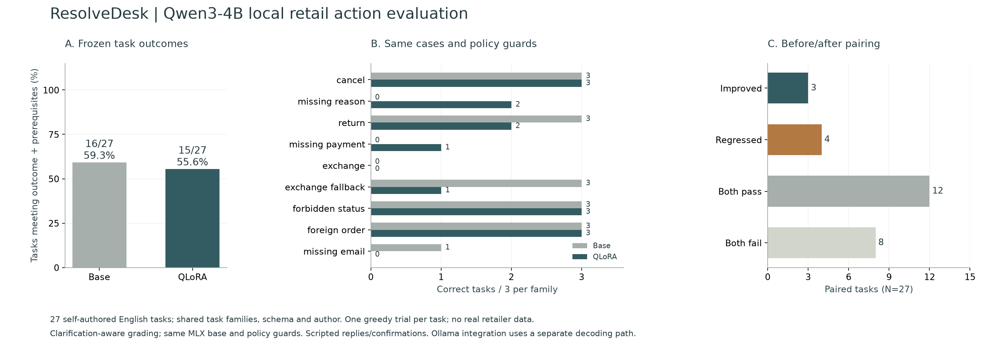

# Archived ResolveDesk first experiment

The first pilot used 72 synthetic training tasks, 18 validation tasks and 27 test tasks across nine families. Its original code and app are preserved at Git commit `06fabd6`. The current [second experiment](../training/v2/README.md) uses different tasks, additional constraints and three comparison arms; its percentages are not directly comparable.

| Original fixed MLX comparison | Base | Selected QLoRA v1 |
| --- | ---: | ---: |
| Task success with information prerequisites | 16/27 | 15/27 |
| Required clarification | 3/9 | 7/9 |
| Schema-valid actions | 118/118 | 151/152 |
| Rejected write attempts | 14 | 16 |
| Median local task time | 4.47 s | 8.27 s |

The candidate was not promoted. Paired outcomes were 3 improved, 4 regressed, 12 both passed and 8 both failed. Original outcome-only matches (21/27 → 16/27) are retained alongside the corrected scores. The initial grader could reward guessing a missing cancellation reason or payment method. Both variants were regraded uniformly from the saved model/tool trajectories using the already-frozen policy, without changing weights, prompts, cases or outputs.

[Original trajectories](../reports/evaluation.json) · [Corrected scores](../reports/evaluation-graded.json) · [Training](../reports/training.json) · [Nonpromotion decision](../reports/release-gate.json) · [Detailed method](../training/README.md)

The repeated identity lookup and failed exchanges informed round 2. These first-round test errors are therefore development evidence, rather than a fresh final test for later tuning. No weights or records from this experiment were replaced by the second run.
