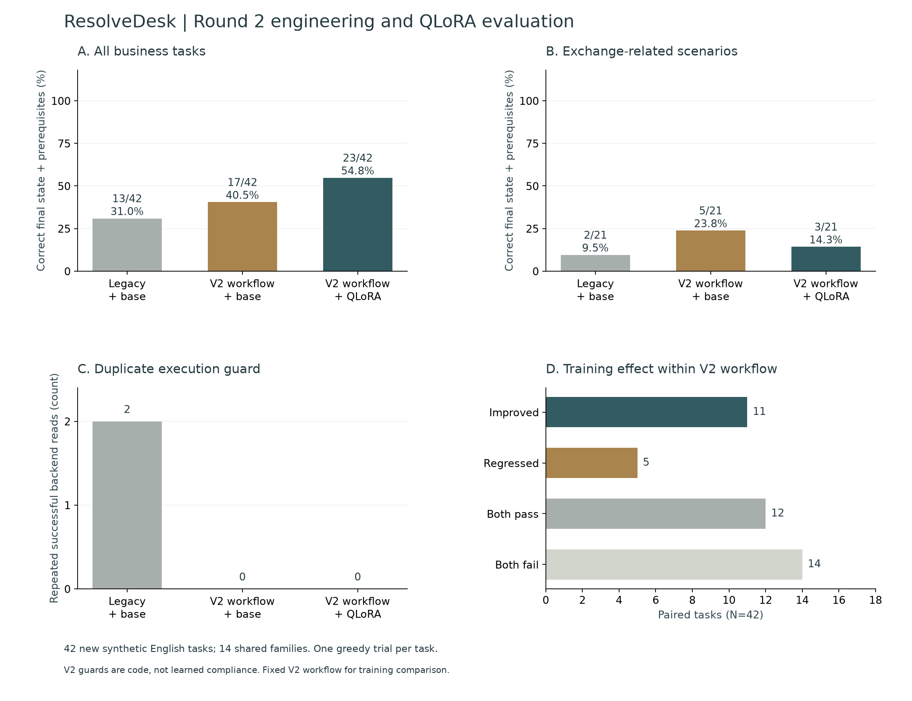
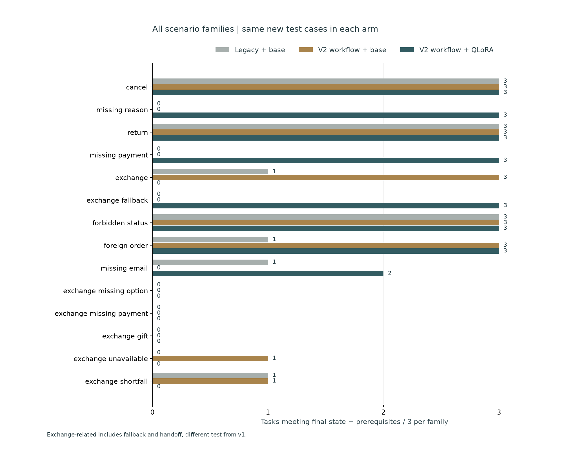
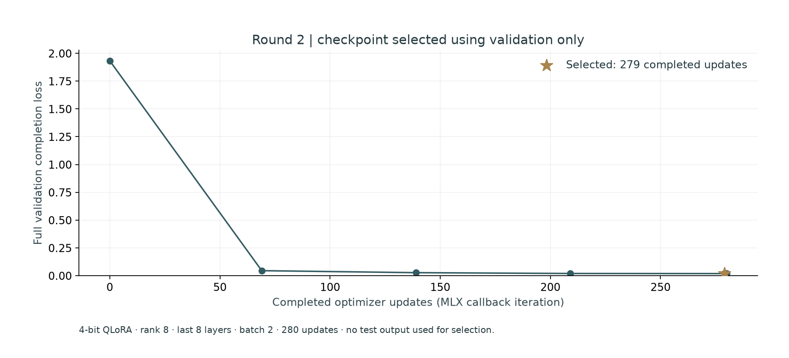

> Archived second experiment; see the current project README for round 3.

# Archived round 2 · controlled QLoRA experiment

An English text agent running locally with Qwen3. It inspects customer/order/catalog facts, asks for missing information, proposes a cancellation, return or variant exchange, and waits for explicit confirmation. The project includes progress-aware tools, transactional approvals, actual 4-bit QLoRA training and a reproducible three-arm evaluation.

**Current round 2:** the legacy controller + base resolves **13/42**, the revised controller + base **17/42**, and the revised controller + selected QLoRA **23/42** on a new synthetic test. The candidate does not meet every predeclared promotion condition. It remains an explicitly selectable local candidate. There are **5 paired regressions**. Ordinary exchanges change from **3/3 to 0/3**. Aggregate improvement does not mean that the exchange problem is fully solved. Ollama remains the default separate integration; the actual v2 adapter is available through MLX. No claim is made that Ollama is superior to either MLX model.

## Measured outcomes

| New fixed v2 test | Legacy + base | V2 + base | V2 + QLoRA |
| --- | ---: | ---: | ---: |
| Task success with prerequisites | 13/42 | 17/42 | 23/42 |
| Ordinary exchange requests | 1/3 | 3/3 | 0/3 |
| Exchange-related scenarios | 2/21 | 5/21 | 3/21 |
| Available exchanges fulfilled | 1/12 | 3/12 | 0/12 |
| Required fields requested | 2/15 | 1/15 | 12/15 |
| Schema-valid actions | 231/232 | 193/194 | 182/182 |
| Repeated successful business reads executed | 2 | 0 | 0 |
| Rejected write attempts | 74 | 41 | 0 |
| Model calls | 232 | 194 | 182 |
| All identical action repeats | 39 | 25 | 4 |
| Median local task time, descriptive | 8.50 s | 6.93 s | 15.23 s |

The first comparison isolates the combined workflow/prompt/catalog changes; the second holds that workflow fixed to measure training. Paired training outcomes: **11 improved, 5 regressed, 12 both passed, 14 both failed**. Repetition prevention is code, not learned compliance. Zero repeated business lookups does not mean zero repeated model attempts or zero internal storage queries. Serial local latency is descriptive, not a production-speed claim.







[Raw trajectories and gate](../reports/v2/evaluation.json) · [Per-case CSV](../docs/figures/v2/per-case.csv) · [Training](../reports/v2/training.json) · [Training protocol](../reports/v2/training-protocol.json) · [Failures](../reports/v2/failure-analysis.json) · [Source verification](../reports/v2/verification.json) · [Full method](../training/v2/README.md)

## What changed

- **Repeated reads:** a successful unchanged identity/order/catalog lookup is not executed again. The model sees the cached facts and recovery feedback; a second blocked repetition hands off. A changed order revision permits a fresh order read. Failed lookups can be corrected. Other failures retain the bounded eight-call budget and remain visible.
- **Exchange decisions:** inspected catalog results list all different same-product candidates, stock and exact positive/negative price differences. State gates require order and catalog inspection. The model still has to choose the requested option, copy its item ID and honor the authorized payment/fallback. Wrong but available variants still fail grading.
- **Write integrity:** the model proposes only. Customer confirmation is bound to an immutable proposal, session and current order revision. Order, receipt, proposal, session and audit commit atomically. Retrying the same proposal returns the same receipt; changed intent revokes pending proposals.
- **Targeted post-training:** clean and injected-error recovery trajectories cover missing fields, wrong IDs, skipped catalog inspection, repeated lookups, authorized returns, unavailable variants, negative price differences and gift-card shortfalls.
- **Attributable evaluation:** the original experiment is preserved. A new test, frozen before training/model test inference, separates engineering effects from parameter updates and retains regressions rather than counting only successful examples.
- **Semantic evaluation:** valid JSON and accepted arguments are insufficient. The adapter produced 182/182 schema-valid actions and zero rejected writes, yet fulfilled 0/12 requested available exchanges. Wrong-operation proposals are still task failures. Low completion loss did not predict correct exchange decisions in this run.

The new suite contains **112/28/42 train/validation/test tasks**, **864/108/162 reference decision snapshots**, and 14 shared families. It is self-authored synthetic data with one order, one product and three variants per task. IDs, prices, requested colors and opening templates differ across splits, but the author, policy, schema and per-family request cores are shared. Reference demonstrations and field-keyed customer replies are programmatic, not human annotations or real retail transcripts. There are 21 exchange-related test scenarios, including fallback/handoff, and 12 available exchanges to fulfill. This is not an official τ-bench score or evidence of real business savings.

## Actual local training

The same pinned official `Qwen/Qwen3-4B-MLX-4bit` base is used, revision `52a5ab34fa604bc8af6d3ce0cac0cab10b7eb495`. A new adapter starts from the base, not the rejected v1 adapter. Rank 8 QLoRA in the last eight layers updates **3,670,016 parameters**, batch 2, learning rate 0.00005, seed 20261027 and 280 updates. Training and validation took **36.12 minutes**; peak MLX allocation was **5.26 GB**. The selected **279-update** checkpoint has full validation completion loss **0.0185526** and adapter L2 change **4.26207** from initialization.

All nine base model/tokenizer/license fingerprints are verified. Completion-only masks are audited; the longest training example is 1,550 tokens, below the 3,072-token cap, with no truncation. Selection uses only validation loss. Both v2 comparison arms use the exact same controller, tools, greedy unconstrained decoding and eight-call budget. No test-based checkpoint selection, JSON repair or oracle fallback is used. The separate Ollama path uses GGUF and JSON Schema decoding; it is not substituted for the causal MLX baseline.

Predeclared local candidate rule:

- `overall_improved`: pass
- `exchange_improved`: fail
- `confirmation_preserved`: pass
- `no_nonexchange_paired_regressions`: pass
- `rejected_writes_not_increased`: pass

The exact earlier cancellation request was replayed against the same Ollama model/profile with the new controller: 8 → 3 model calls; correct confirmation-bound proposal: **True**. [The first replay and all raw actions are retained](../reports/v2/live-ollama-regression.json). This is one validation smoke, not held-out accuracy or a training comparison.

The [actual browser verification](../reports/v2/live-browser-verification.json) separately records a correct negative-difference Ollama exchange, a wrong return from the selected adapter that was declined, and a pending Ollama cancellation. These are validation integrations, not additional held-out scores.


## Run the workspace

Use Python 3.12, uv, an existing local Ollama installation and `qwen3:4b`:

```bash
uv sync --frozen
uv run python -m training.setup_ollama
uv run resolvedesk serve --port 8771
```

Open [the local workspace](http://127.0.0.1:8771/). Select one of 14 validation contexts, edit the English request, inspect the actual tool trace and review the exact proposal before confirming. Each session gets isolated sandbox orders. The current evaluation and first-round archive are separate selections in Model evaluation. Setup creates a template-only Ollama profile from existing weights; it does not train or overwrite the original model. Dispatch uses application JSON, not native `tool_calls`. `.env.example` documents process environment variables; `.env` is not loaded automatically.

After reproducing the [training workflow](../training/v2/README.md), serve the selected adapter separately:

```bash
HF_HUB_OFFLINE=1 TOKENIZERS_PARALLELISM=false training/.venv/bin/python -m training.v2.serve
```

It binds to loopback port 8772 and verifies the selected weights' hash. Choose **Experimental QLoRA v2 · MLX**. The adapter has not been merged into Ollama/GGUF. All services bind to loopback. All customer identities, orders, payments and gift cards are simulated; no money moves or email is sent. Email lookup is demo identity resolution, not production authentication. Live catalog updates and multi-item orders are outside this prototype.

## Verification and attribution

```bash
uv run pytest -q
uv run ruff check resolve_desk training tests
node --check --input-type=module < resolve_desk/static/app.js
uv run python -m training.v2.verify_results
```

**46 Python tests passed locally.** Tests cover rollback, idempotency, session/order revisions, ownership, invalid variants/payments, no oracle input, duplicate execution prevention, changed-order refresh, false clarification guesses, wrong-but-valid variants, frozen inputs and delivered result reconciliation. Real MLX/Ollama calls are separate from injected-model unit tests. GitHub CI is configured; no remote run is claimed.

The policy is adapted from [Sierra Research τ-bench v2.0.0](https://github.com/sierra-research/tau2-bench/releases/tag/v2.0.0), pinned to `989d3285ae669e49503324bdb9981bf14fccedeb`; its MIT license and policy are retained in [third_party/tau-bench](../third_party/tau-bench/README.md). ResolveDesk supplies its own limited tools, controller, UI, cases, training and evaluator; it does not run the official task database, user simulator or judges. Qwen weights retain their Apache-2.0 license. Model weights, databases and credentials are excluded from Git.

The [first experiment](../docs/round-1.md), including its regression and grading correction, is preserved. Its test failures informed this redesign, so they are development evidence. Further tuning after round 2 requires another held-out test set.

## Resume wording

> Built a local Qwen3 retail-action agent with progress-aware tools, variant/price validation and confirmation-bound idempotent transactions. Created 112/28/42 synthetic train/validation/test tasks and trained a 3.67M-parameter QLoRA adapter. Improved task success from 17/42 to 23/42 with the workflow held fixed while retaining 5 paired regressions for failure analysis on the new synthetic suite; blocked promotion because of exchange regressions and verified the system with 46 engineering tests.

Keep the synthetic-data limitation and the actual comparison group with every quantitative claim.
