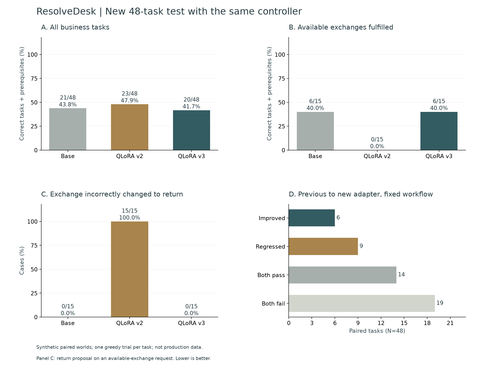
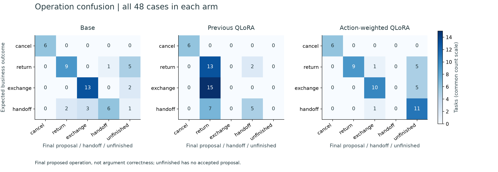
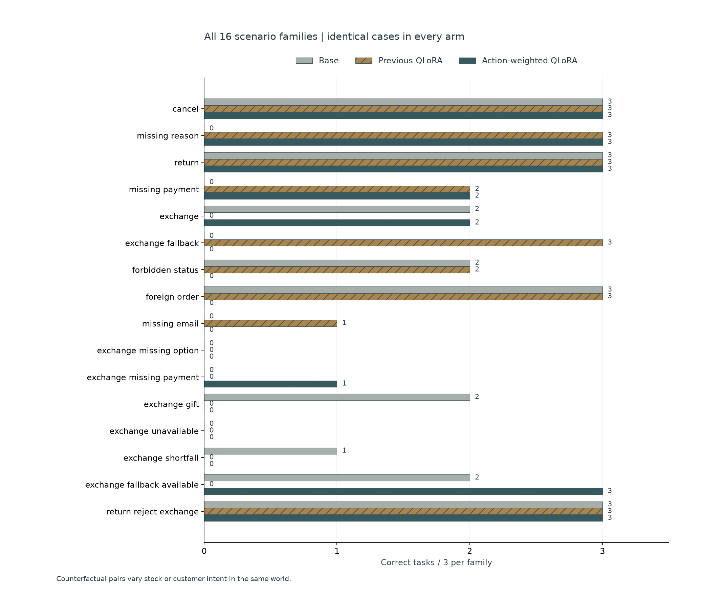
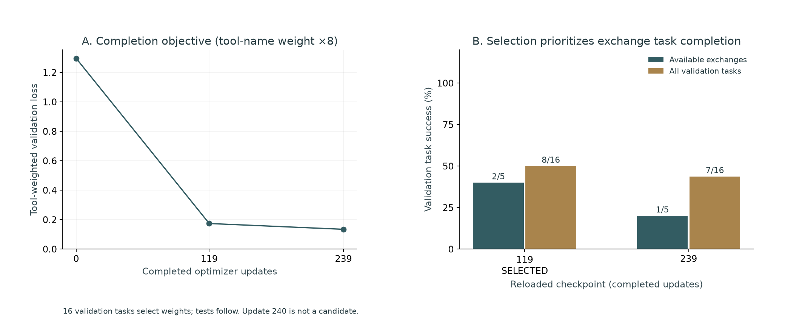

> Archived round 3. See the current [project overview](../README.md).

# ResolveDesk · Local Retail Action Agent

An English retail support agent running locally with Qwen3. It reads customer/order/catalog facts, asks for missing details and proposes a cancellation, return or variant exchange. Explicit customer confirmation commits an immutable proposal atomically and idempotently. All customers, payments and orders are simulated.

**Round 3 targets exchange → return confusion.** On a new 48-task synthetic test, mistaken returns on 15 available-exchange requests change from **15/15 to 0/15**, available exchanges completed from **0/15 to 6/15**, and overall task success from **23/48 to 20/48**. The unchanged base resolves **21/48**. The new adapter **does not pass** the predeclared local candidate gate. Ollama remains the default integration; v3 MLX is explicitly selectable. This is a local prototype, not a production deployment.

**Overall success regressed by 3 tasks relative to v2.** Reducing this error class did not improve the whole agent.

## Measured outcomes

| New fixed v3 test · same controller | Base | Previous QLoRA v2 | New QLoRA v3 |
| --- | ---: | ---: | ---: |
| Exchange incorrectly changed to return ↓ | 0/15 | 15/15 | 0/15 |
| Available exchanges fulfilled ↑ | 6/15 | 0/15 | 6/15 |
| All tasks with prerequisites ↑ | 21/48 | 23/48 | 20/48 |
| Ordinary exchanges | 2/3 | 0/3 | 2/3 |
| Direct-return negative controls | 6/12 | 9/12 | 8/12 |
| Required fields requested | 2/15 | 8/15 | 7/15 |
| Schema-valid actions | 226/227 | 202/202 | 299/301 |
| Confirmation preserved | 48/48 | 48/48 | 48/48 |
| Unauthorized return attempts | 2 | 21 | 1 |
| Repeated business reads executed | 0 | 0 | 0 |
| Rejected write attempts | 50 | 1 | 18 |
| Model calls | 227 | 202 | 301 |
| Median local time, descriptive | 16.13 s | 15.80 s | 14.52 s |
| All identical action repeats | 33 | 5 | 106 |
| Expected handoffs completed | 6/12 | 5/12 | 0/12 |

All three arms use the same frozen v2 controller, prompts, tools, tokenizer, greedy unconstrained decoding and eight-call budget. We change the combined training data/objective/checkpoint-selection recipe; this is not an ablation separating each component. Relative to v2, paired outcomes are **6 improved, 9 regressed, 14 both passed and 19 both failed**. Mistaken-return counts include any return attempt on an available-exchange request. Authorized unavailable-stock fallbacks are excluded. Task success also requires the right variant, payment, exact amount, required information and confirmed/declined final state. Zero repeated executed reads is a controller invariant, not proof of no repeated model attempts. Serial latency is descriptive.

**Observed regressions:** exchange_fallback: 3, forbidden_status: 2, foreign_order: 3, missing_email: 1. Among failed new-adapter runs, **26** repeat the same clarification field, and **1** unavailable-stock fallback cases propose an exchange instead of the authorized return. These are trajectory observations; they do not isolate a training component as the cause. A zero mistaken-return count on available exchanges does not establish general policy compliance. The new weights remain experimental.









[Raw 144 trajectories](../reports/v3/evaluation.json) · [Per-case CSV](../docs/figures/v3/per-case.csv) · [Every failed run](../reports/v3/failure-analysis.json) · [Training and adapter fingerprints](../reports/v3/training.json) · [Verification](../reports/v3/verification.json) · [Full method and reproduction](../training/v3/README.md)

## Personal implementation and improvements

- Built the local action workspace, typed tools, progress-aware read cache, revision checks and transactional approvals. Proposals do not mutate orders. Confirmation binds session, immutable proposal and current order revision; replay returns the same receipt. Changed intent revokes pending proposals.
- Diagnosed the previous adapter's semantic failure: valid JSON and accepted arguments still selected returns for every available exchange in its earlier test. That old test is now development evidence, preserved unchanged.
- Added counterfactual training worlds: identical request with stock available/unavailable, and identical catalog/order with explicit exchange/return intent. Added customer corrections after wrong returns and direct returns after catalog inspection; only correct next actions are supervised.
- Changed the actual MLX training loss: exact JSON tool-name token spans receive **8×** weight; other completion tokens receive 1× and prompt/padding tokens 0. Available-exchange terminal decisions are sampled 3× and correction snapshots 2×. This is a parameter update, not a renamed Ollama template.
- Selected exported checkpoints using real **validation business outcomes**, prioritizing completed exchanges over total successes, wrong-return counts and weighted loss. All 16 validation tasks run in a fresh adapter-loading process. The 48 test tasks never select the checkpoint.
- Added semantic confusion matrices, paired regressions, exact trace/CSV reconciliation, hash-verified UI evidence and negative controls for genuine returns. No inference keyword routing, forced exchange action or oracle fallback is added.

## Data and actual training

**128/16/48 train/validation/test tasks**, 16 families, and **480/62/186 reference snapshots**. Within-split counterfactuals intentionally share worlds: **112/14/42 distinct order IDs**. Generated entity IDs and worlds are separated across splits and earlier experiments; phrasing is split-specific and prices are generated independently. The author, policy, schema, domain language and most scenario families are shared. Demonstrations and field-keyed customer replies are programmatic. Tasks are synthetic and correlated; there are no human retail annotations, independent wording judges, production-generalization claims or statistical-significance claims.

The pinned official `Qwen/Qwen3-4B-MLX-4bit` revision is `52a5ab34fa604bc8af6d3ce0cac0cab10b7eb495`. A new adapter starts from this base, not the old adapter or preflight weights. Rank 8 supervised QLoRA fine-tuning in the last eight layers updates **3,670,016 parameters**, batch 1, learning rate 0.00005, seed 202610273, 240 optimizer updates. The selected checkpoint has **119 completed updates**, adapter L2 change **4.03717**, and weighted validation loss **0.173210**. Training plus validation took **31.69 minutes**, with **4.16 GB** peak parent-process MLX allocation; the validation child allocation is not included. All nine base fingerprints are verified. Longest training snapshot: 1,590 tokens under the 2,048-token cap; no truncation. Weighted loss cannot be compared numerically to v2's unweighted loss.

Only the predeclared positive candidates at 119 and 239 completed updates are eligible; final-update 240 weights are retained but excluded. All selection trajectories and failures are retained. The candidate gate is a local prototype rule:

- `available_exchange_improves_v2`: pass
- `available_exchange_not_below_base`: pass
- `zero_exchange_as_return`: pass
- `ordinary_exchanges_all_pass`: fail
- `overall_not_below_either_comparator`: fail
- `direct_returns_not_below_base`: pass
- `no_nonexchange_base_regressions`: fail
- `confirmation_preserved`: pass

Further training on these test failures requires a new held-out test. [Round 1](../docs/round-1.md) and [round 2](../docs/round-2.md), including their regressions and figures, remain archived.

## Run locally

Use Python 3.12, uv, local Ollama and existing `qwen3:4b` weights:

```bash
uv sync --frozen
uv run python -m training.setup_ollama
uv run resolvedesk serve --port 8771
```

Open [ResolveDesk](http://127.0.0.1:8771/). Choose one of 16 new validation contexts, edit the English request and inspect actual tool actions and exact proposals. Every session has isolated sandbox orders. Model evaluation defaults to the new comparison; two old experiments remain selectable. Validation fixtures exposed to the application contain no expected outcomes or scripted answers; test cases are inaccessible to the case API. Email lookup is demo identity resolution, not production authentication. Multi-item orders, live retail systems and real financial transactions are outside this prototype.

After following the [training setup](../training/README.md) and [round-3 reproduction](../training/v3/README.md), serve the actual selected adapter separately:

```bash
HF_HUB_OFFLINE=1 TOKENIZERS_PARALLELISM=false training/.venv/bin/python -m training.v3.serve
```

The loopback service on 8772 verifies the selected adapter fingerprint. Choose **QLoRA v3 · MLX**. It is not merged into Ollama/GGUF. Ollama's template-only local profile and schema-constrained decoding are a separate integration, not a substitute for the causal MLX comparison. `.env.example` describes process variables; `.env` is not loaded automatically. Model weights, databases and credentials are excluded from Git.

Actual loopback app/selected-adapter probes produced 3 correct proposals in 3 validation worlds after field-keyed scripted customer replies. The original stops for extra clarification are preserved. Confirmation did not write before approval, and repeated confirmations returned identical receipts. Each API advance has its own eight-step budget; these are integration checks, not the eight-total-call held-out benchmark or human customer judgments. [Full API conversations and approvals](../reports/v3/live-api-verification.json) · [Initial clarification stops](../reports/v3/live-api-initial.json).


The [browser verification](../reports/v3/browser-verification.json) also retains a separate default-Ollama validation exchange: five actual model calls, an initially rejected attempt before catalog inspection, and a correct pending proposal. Its isolated order remains unchanged before confirmation. This is integration evidence, not a trained-model test score.


## Verification and attribution

```bash
uv run pytest -q
uv run ruff check resolve_desk training tests
node --check --input-type=module < resolve_desk/static/app.js
uv run python -m training.v3.verify_results
```

**55 Python tests passed locally.** They cover transaction rollback, idempotency, revisions, ownership, payment/variant validation, repeated reads, genuine-return controls, exact action weighting, validation-only selection, frozen data and delivered-result reconciliation. Real MLX/Ollama integration runs are recorded separately; no remote CI run is claimed.

Policy attribution: [Sierra Research τ-bench v2.0.0](https://github.com/sierra-research/tau2-bench/releases/tag/v2.0.0), pinned to `989d3285ae669e49503324bdb9981bf14fccedeb`; policy and MIT license are retained in [third_party/tau-bench](../third_party/tau-bench/README.md). ResolveDesk implements its own limited controller, tools, UI, datasets, training and evaluator. It does not run official tasks, simulator or judges and does not claim an official τ-bench score. Qwen weights retain their Apache-2.0 license.

## Resume wording

> Built a local Qwen3 retail-action agent with revision-aware tools and confirmation-bound idempotent transactions. Diagnosed exchange/return confusion and implemented counterfactual correction data, 8× tool-name weighted QLoRA and validation-business checkpoint selection (3.67M trainable parameters). On a fresh 48-task synthetic test with a fixed controller, changed mistaken returns from 15/15 to 0/15, completed exchanges from 0/15 to 6/15, and overall success from 23/48 to 20/48; retained 9 paired regressions and verified with 55 engineering tests.

Keep the synthetic scope, remaining failures and exact comparison group with every quantitative claim.
