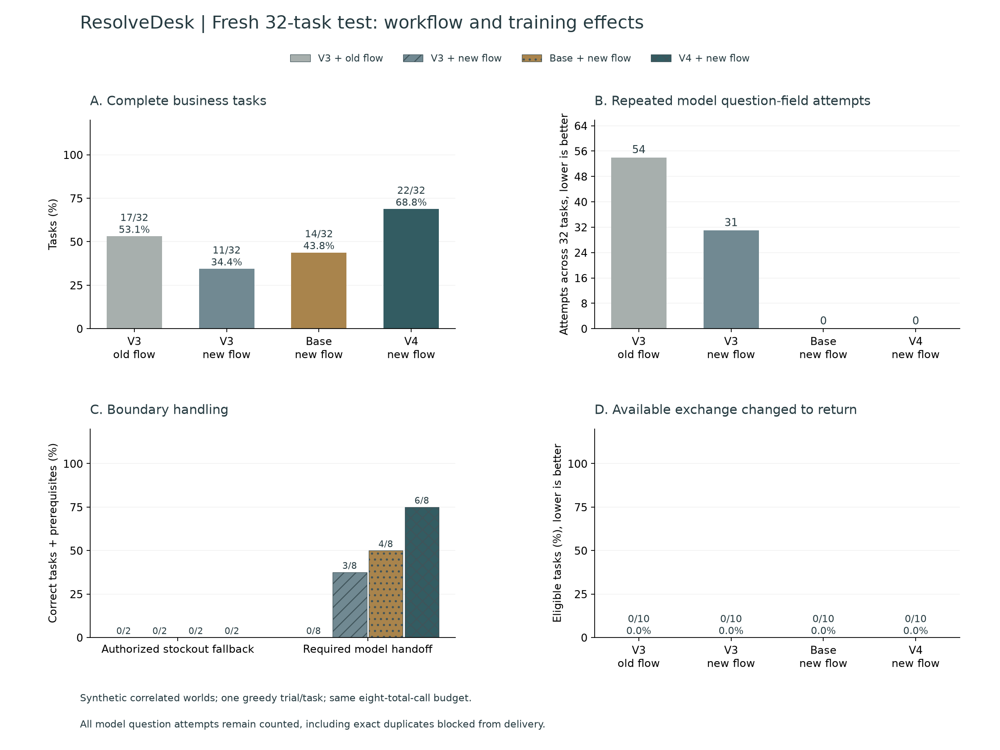
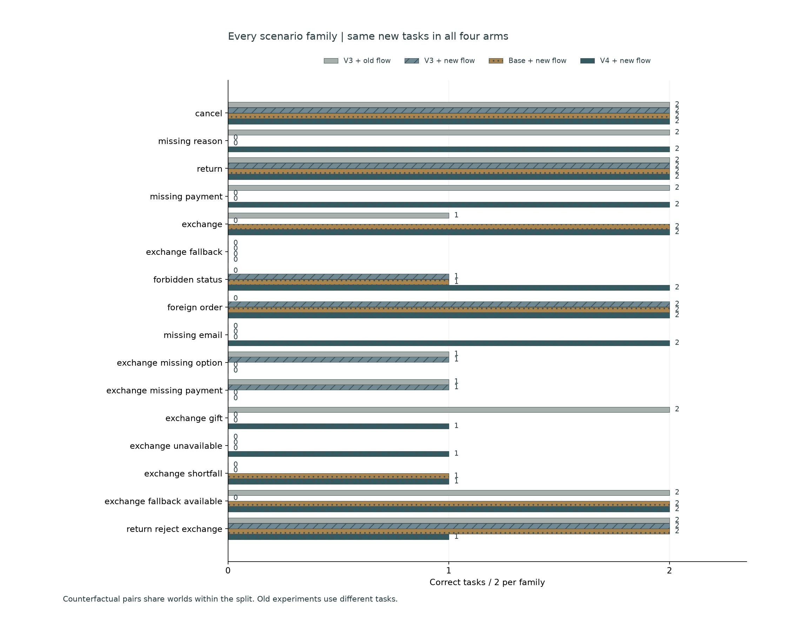
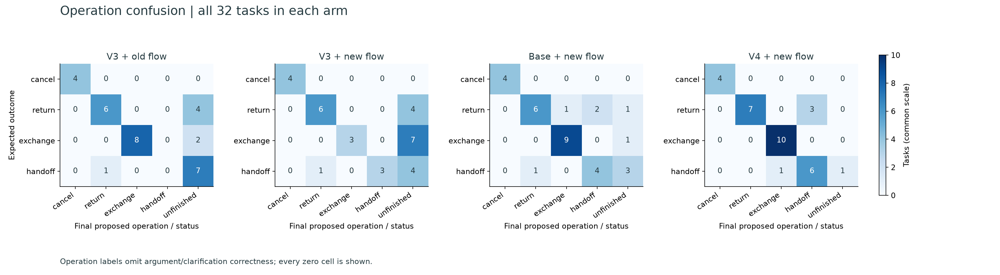
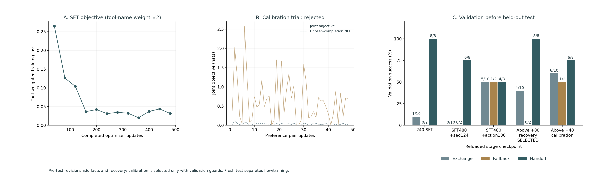

# ResolveDesk · Local Retail Action Agent

An English retail action agent using local Qwen3 inference. It inspects customer/order/catalog facts, requests missing information and proposes a cancellation, return or exact-variant exchange. Explicit customer confirmation commits an immutable proposal atomically and idempotently. Every customer, order, payment and human handoff is simulated.

**Round 4 targets repetitive clarification, authorized stockout returns and policy handoff while preserving exchange intent.** On **32 fresh synthetic test tasks**, training under the fixed new workflow changes repeated question-field attempts from **31 to 0**, stockout fallback success from **0/2 to 0/2**, model handoff success from **3/8 to 6/8**, and overall success from **11/32 to 22/32**. Available-exchange return errors are **0/10**. The candidate **passes** the fixed local prototype gate. Ollama remains the default integration; actual V4 adapter weights are explicitly selectable through MLX.

**Authorized stockout fallback remains incomplete; this round does not fully resolve that target.** A relative local gate does not replace the absolute outcome counts below.

## Four-arm measured comparison

| Fresh v4 test | V3 + old flow | V3 + new flow | Base + new flow | V4 + new flow |
| --- | ---: | ---: | ---: | ---: |
| Task success with prerequisites | 17/32 | 11/32 | 14/32 | 22/32 |
| Available-exchange tasks handled correctly | 7/10 | 2/10 | 4/10 | 5/10 |
| Authorized out-of-stock fallback | 0/2 | 0/2 | 0/2 | 0/2 |
| Expected handoff completed by model | 0/8 | 3/8 | 4/8 | 6/8 |
| Exchange incorrectly changed to return ↓ | 0/10 | 0/10 | 0/10 | 0/10 |
| Direct-return controls | 6/8 | 4/8 | 4/8 | 7/8 |
| Required clarification obtained | 7/10 | 5/10 | 1/10 | 6/10 |
| Schema-valid actions | 200/201 | 175/179 | 144/144 | 135/135 |
| Confirmation preserved | 32/32 | 32/32 | 32/32 | 32/32 |
| Repeated model question-field attempts ↓ | 54 | 31 | 0 | 0 |
| Repeated field questions delivered ↓ | 54 | 0 | 0 | 0 |
| All identical action repeats | 67 | 41 | 21 | 5 |
| Unauthorized return attempts | 1 | 0 | 0 | 0 |
| Model calls | 201 | 179 | 144 | 135 |
| Rejected writes | 9 | 9 | 32 | 3 |
| Median local time, descriptive | 35.11 s | 39.17 s | 20.34 s | 21.42 s |
| Verified handoffs / model handoffs | 0/0 | 3/3 | 4/6 | 6/9 |
| Unnecessary model handoffs ↓ | 0/24 | 0/24 | 2/24 | 3/24 |

V3 old → new flow measures the combined clarification-memory, duplicate-question guard, policy guidance and observed affordability facts. V3 → V4 under the **same new flow** measures the bundled new training recipe. Base + new flow supplies a quality comparator. All arms use the same pinned MLX base/tokenizer, unconstrained greedy decoding and **eight total model calls per task**. They run serially; background GPU/memory contention varied, so latency is descriptive and does not support a speedup claim. Workflow improvements must not be attributed to training.

Paired V3 → V4 training outcomes: **14 improved, 3 regressed, 8 both passed, 7 both failed**. All failures remain inspectable. A lower aggregate error count does not erase per-task regressions.









[All 128 raw trajectories](../reports/v4/evaluation.json) · [Per-case CSV](../docs/figures/v4/per-case.csv) · [Failures](../reports/v4/failure-analysis.json) · [Weight updates and protocol revision](../reports/v4/training.json) · [Verification](../reports/v4/verification.json) · [Method](../training/v4/README.md)

Handoff recall alone is insufficient. The new adapter has **6 verified handoffs among 9 actual model handoffs**, and unnecessarily hands off **3/24** non-handoff tasks. These post-hoc operational diagnostics explain the fixed raw trajectories; they do not change checkpoint selection or the gate.

## Implementation and personal contributions

- Built typed retail tools, progress-aware reads, an inspectable local UI, ownership/status/variant/payment checks and confirmation-bound transactions. Approval atomically commits order, session, proposal, receipt and audit; replay returns the same receipt. Changed intent revokes pending proposals.
- Added **observed clarification memory**: actual tool questions are associated with the next actual customer reply. Replies remain unverified text. A new unsolicited customer message resets old clarification context. No fixture answers, task labels or expected outcomes enter the model prompt.
- Blocked exact duplicate question delivery after a reply while retaining the attempted action and recovery feedback. Different precise followups remain possible. This guard does **not** force a successful outcome or automatically hand off; repeated model attempts remain counted.
- Exposed observed order eligibility and actual access-denial signals. The code uses tool results, not intent keywords or a gold-answer router. The model must choose between exact-variant exchange, authorized stockout return and handoff from the customer's request and catalog/payment facts.
- Replaced exchange-heavy terminal oversampling with **complete trajectories plus targeted recovery**: continue after a field answer or blocked repeated question, hand off after unnecessary questions at a policy boundary, reject substitute variants when only a return fallback is authorized, and preserve genuine exchange/return controls.
- Reduced exact tool-name token weight from **8× to 2×**, retained prompt/padding masking and full argument supervision, and trained SFT from the pinned base. After SFT validation exposed excessive handoffs, rejected a 124-pair unregularized sequence-preference attempt on validation, then used 136 train-only action-span preference pairs with chosen-completion NLL. Fixed the final checkpoint before new test inference.
- Added four-arm attribution, raw attempted/delivered-question metrics, actual model-handoff checks, paired regressions, confusion matrices and source/CSV/figure reconciliation. Historical experiments remain unchanged.

## Data, training and limits

**64 train / 32 validation / 32 test tasks**, 16 shared scenario families, and **356/124/124** SFT decision snapshots. The training set contains 68 exchange proposals, 44 return proposals, 48 handoffs, 12 cancellation proposals, 20 clarification requests and 164 read actions. Extra terminal copies are weights, not new unique tasks. Within-split counterfactual pairs intentionally share worlds: **56/28/28 distinct order IDs**. Generated entities and split-specific phrasing are disjoint across splits and old experiments; prices are generated independently. The author, policy, schema, domain language and scenario families remain shared.

All data are self-authored synthetic examples with field-keyed scripted replies and confirmations. They are correlated, not independently human-annotated retail conversations. Repeated-field attempts count every additional ask for the same field; these synthetic replies are usable and unambiguous. Different wording can still count as a repeat even when the exact-duplicate delivery guard allows it. Handoff success additionally requires an actual model `handoff` action. Wrong available variants, missing required information and wrong payment/amount remain failures. Available-exchange return errors exclude correctly authorized unavailable-stock returns. These measurements do not establish customer satisfaction, statistical significance, real business savings or production reliability.

The official `Qwen/Qwen3-4B-MLX-4bit` base remains pinned to `52a5ab34fa604bc8af6d3ce0cac0cab10b7eb495`; all nine model/tokenizer/license fingerprints are verified. Rank 8 supervised QLoRA updates **3,670,016 parameters** in the last eight layers, batch 1, learning rate 0.00003, seed 202610274 and **480 updates**. The longest training snapshot is 1,884 tokens under the 2,560-token cap; no truncation. Numerical mask/weight audits confirm a tool/argument equal-error loss ratio of approximately 2.

The selected final lineage has **696 updates**: **480 SFT + 136 action-preference/NLL + 80 recovery-state updates**, and adapter L2 change **2.78141** from initialization. Selected-lineage optimizer training took **84.18 minutes**; final business validation took **14.00 minutes** separately. Peak MLX active allocation across those final training processes was **4.32 GB**, excluding cache, OS memory and other processes. Failed attempts, earlier validation and preflights are excluded from that final update duration and remain separately recorded. Business validation covers 32 development tasks; weighted snapshot loss is not recomputed or used for the final guarded choice.

Several validation-guided revisions preceded **any v4 test inference**. SFT-240 scored **13/32**, with 1/10 exchanges, 0/2 fallback and 8/8 handoffs; SFT-480 validation was interrupted after similar failures. A 124-update unregularized sequence-preference attempt then scored **6/32**, with **23/24 unnecessary handoffs** on normal tasks. Its raw actions show alternative refusal wording instead of correct operations. Its training, weights and validation are preserved; those weights are not reused.

The final recipe restarts from **SFT-480**. Inspired by the pairwise objective and supervised regularization discussed in the [SimPO paper](https://arxiv.org/html/2405.14734v2), it compares **exact action-name token log probabilities**, and adds mean NLL over **all chosen completion tokens**, including arguments and end-of-turn tokens. This application-specific action-span reward differs from standard full-response SimPO. Beta 2, margin 0.5, NLL coefficient 1, Adam learning rate 0.000003, seed 2026102742 and **one fixed pass of 136 pairs**: the original 124 train-only pairs plus 12 genuine-return versus wrong-exchange controls. Negative reason wording cannot satisfy the action-name preference term.

The numerical gradient and finite-difference audit, complete target-mask coverage, selected-position versus full output-projection check, and real one-update preference/NLL improvements are retained in [action-preflight.json](../reports/v4/action-preflight.json). Only the output head is projected over the last 256 positions; context is preserved and every supervised completion token is covered. Training caps wired memory at 6 GiB and cache at 256 MiB and releases freed buffers each pair. The earlier six-update eager run, 18-update cache-pressure run and compiled-state preflight repair remain archived. Preflight and failed-run weights are not reused.

The action-only candidate scored **17/32** on validation: 5/10 exchanges, 1/2 fallback and 4/8 model handoffs. Missing-field defaults, substitute variants and unauthorized returns remained failures. Its raw report is retained; it prompted a final pre-test recovery revision.

The final recovery phase continues from that action-136 adapter with **80 state pairs from 52 original training tasks**, seed 2026102743, learning rate 0.000003 and the same action-name preference/NLL objective. It adds missing-field questions after real reads, contrasts handoff with unsafe exchange/return, and preserves answered continuations, available exchanges and genuine returns. Input augmentation lists **every observed candidate** with exact price difference and gift-card coverage, computed only from completed tools. It never selects an answer or routes customer intent. The same augmentation and policy contract reach every new-flow comparator. [Recovery preflight](../reports/v4/recovery-preflight.json) checks gradients, full-target coverage and actual update effects. The first low-rate preflight and pre-training rate revision are archived; no preflight weights are reused.

A final balanced conditional calibration trial uses **24 pairs, 20 controlled contexts and 12 original training worlds**, repeated for two epochs (48 updates, seed 2026102744). Stock and return-permission counterfactuals share worlds. Eight return, eight exchange and eight handoff pair labels prevent class weighting from erasing the return exception. Same-tool payment contrasts reward unquoted payment-value tokens; action contrasts reward tool-name tokens. The single-update quote-mask repair and discarded prefix are archived. [Payment token audit](../reports/v4/calibration-token-audit.json) independently checks all eight chosen/rejected payment masks.

The final weight choice uses only validation, under a rule frozen before calibration: zero exchange-as-return, no losses in overall/exchange/handoff/clarification/direct-return successes or question repeats, then prefer fallback success, overall success and fewer questions/calls. Calibration adoption is **False**. [Choice rule](../training/v4/calibration_choice.py) and both validation candidates remain inspectable. No new test result selects weights. Its 32-task validation scored **24/32** on the development set used for guarded selection. The four-arm test measures the combined revised SFT + action-preference/NLL recipe, without an ablation isolating the individual training changes. Separate SFT, sequence, action, recovery and calibration manifests bind all five stages. Earlier SFT preflight repair remains in [preflight-repair.json](../reports/v4/preflight-repair.json).

The calibration trial validated at **22/32**, including **1/2 fallback, 6/8 model handoff and 5/8 direct returns**. The selection rule evaluates all protected metrics; a fallback gain alone cannot justify regression elsewhere. The selected checkpoint and the rejected trial both remain archived.

Fixed local candidate checks:

- `task_success`: pass
- `fulfillable_exchange_success`: pass
- `fallback_success`: pass
- `handoff_success`: pass
- `zero_exchange_as_return`: pass
- `repeated_questions_not_increased`: pass
- `repeated_questions_reduced_if_present`: pass
- `confirmation_preserved`: pass

Question attempts must not increase and must decrease when the previous comparator has repeats. Passing this small local gate is not a production deployment decision. Further tuning based on these test failures requires another frozen test. [Round 1](../docs/round-1.md), [round 2](../docs/round-2.md) and [round 3](../docs/round-3.md) retain their raw results and regressions.

## Run locally

Use Python 3.12, uv, local Ollama and existing `qwen3:4b` weights:

```bash
uv sync --frozen
uv run python -m training.setup_ollama
uv run resolvedesk serve --port 8771
```

Open [ResolveDesk](http://127.0.0.1:8771/). The case library shows one of the two validation contexts per family, 16 examples; all 32 new validation contexts are available to the case API. Archived validation worlds remain for restoring old sessions. Each session has isolated sandbox orders. Expected outcomes and scripted answers are excluded from packaged fixtures; test cases are unavailable to the case API. Email lookup is demo identity resolution, not production authentication. `.env.example` documents process variables; `.env` is not loaded automatically.

For actual trained inference after following the [MLX setup](../training/README.md) and [round-4 method](../training/v4/README.md):

```bash
HF_HUB_OFFLINE=1 TOKENIZERS_PARALLELISM=false training/.venv/bin/python -m training.v4.serve
```

The loopback adapter service on 8772 verifies the selected weight fingerprint. Choose **QLoRA v4 · MLX**. The adapter is not merged into Ollama/GGUF. Ollama's schema-constrained GGUF path is a separate integration and is not substituted for controlled MLX scores. All services bind to loopback and operate on isolated simulated state. Multi-item orders and live retailer systems are outside this prototype. Weights, databases and credentials are excluded from Git.


## Verification and attribution

```bash
uv run pytest -q
uv run ruff check resolve_desk training tests
node --check --input-type=module < resolve_desk/static/app.js
uv run python -m training.v4.verify_results
```

**70 Python engineering tests passed locally.** Real local model evaluations and integration probes are recorded separately. GitHub CI is configured; no remote CI run is claimed. Browser and API verification remain separate from held-out task accuracy.

Actual application → selected MLX adapter validation completed **5/6** scenarios correctly; the failed stockout fallback remains recorded. All six preserve the original order until confirmation, and **3** proposal confirmations have matching idempotent replay receipts. These are development-set wiring/transaction probes, excluded from the 32-task test scores. [Live API records](../reports/v4/live-api-verification.json) and the [browser verification](../reports/v4/browser-verification.json) retain the actual adapter identity and page/figure checks. A fresh Ollama generation smoke was deferred while unrelated model caches remained loaded, respecting the user's preference to leave them untouched.

Policy attribution: [Sierra Research τ-bench v2.0.0](https://github.com/sierra-research/tau2-bench/releases/tag/v2.0.0), pinned to `989d3285ae669e49503324bdb9981bf14fccedeb`; policy and MIT license remain in [third_party/tau-bench](../third_party/tau-bench/README.md). ResolveDesk implements its own limited controller, tools, UI, synthetic data, training and evaluator. It does not run official tasks, simulator or judges and does not claim an official τ-bench score. Qwen weights retain their Apache-2.0 license.

## Resume wording

> Built a local Qwen3 retail-action agent with observable tools, clarification memory and confirmation-bound idempotent transactions. Created 64/32/32 synthetic train/validation/test tasks, implemented recovery-data SFT with 2× action-name weighting and 136 train-only action-span preference updates plus 80 recovery-state updates with chosen-completion NLL and a guarded 48-update conditional calibration trial (3.67M-parameter QLoRA), and separated workflow from training effects using four controlled arms. With the new workflow held fixed, changed repeated question attempts from 31 to 0, authorized fallback completion from 0/2 to 0/2, handoff completion from 3/8 to 6/8, and overall success from 11/32 to 22/32; retained 3 paired regressions and verified with 70 engineering tests.

Keep the exact comparison, synthetic scope, remaining regressions and gate result with every quantitative claim.
