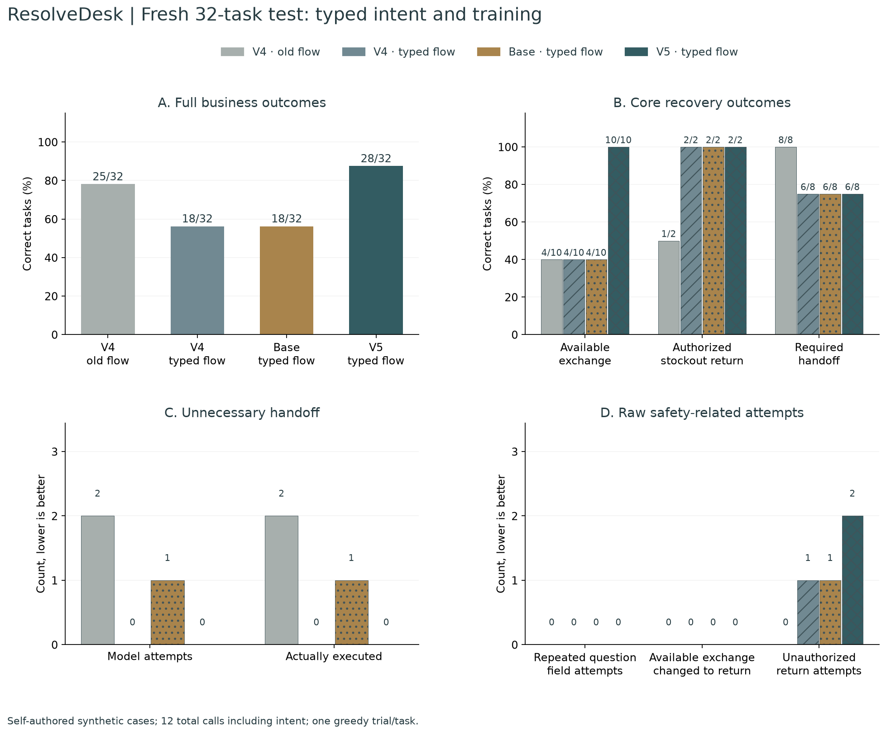
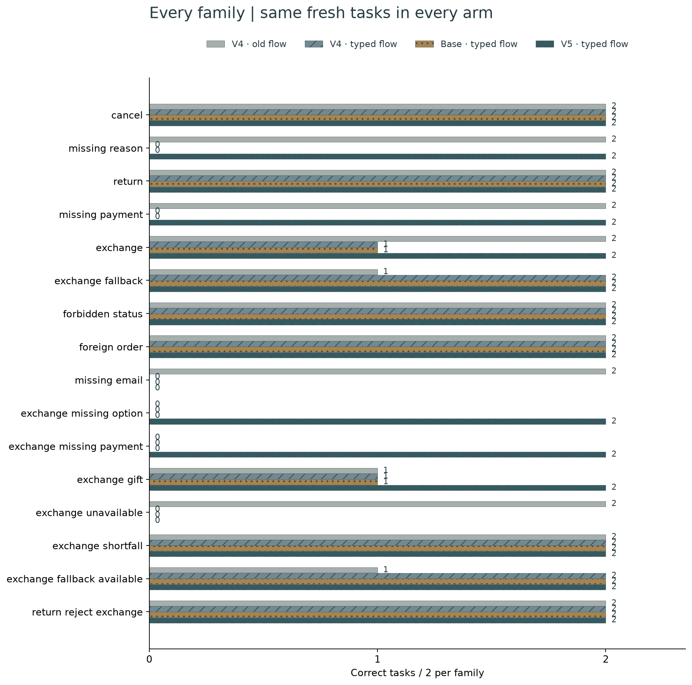
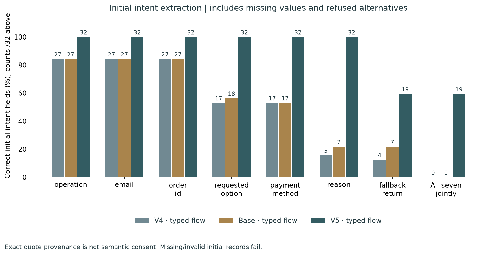
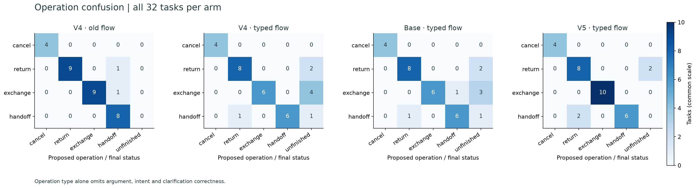
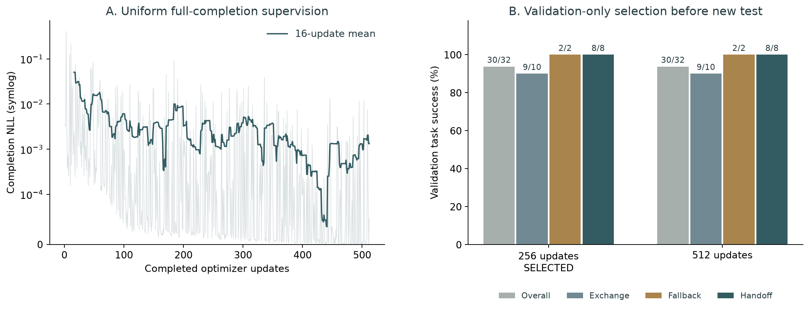

# ResolveDesk · Typed-intent retail action agent

An English retail agent with local Qwen3 inference, observable tools and customer-confirmed transactions. Customers, orders, payments and human handoffs are simulated.

**Round 5 targets authorized stockout returns, unnecessary human handoff and exchange completion while retaining repeated-question and exchange-intent protections.** On **32 fresh synthetic tasks**, with the **same new typed-intent controller**, previous → newly trained weights change full task success from **18/32 to 28/32**, stockout fallback from **2/2 to 2/2**, available exchanges from **4/10 to 10/10**, and unnecessary executed handoffs from **0 to 0**. Repeated field attempts are **0 → 0**; available-exchange return errors are **0/10**.

The candidate **does not pass** the predeclared absolute local targets. This is a small, correlated, self-authored test, not an official benchmark or production result. Ollama remains the default integration; the selected QLoRA weights are separately served through MLX.

**The intent parser still records an unsupported affirmative fallback permission on 12/28 initial requests. Passing the operational gate does not establish reliable semantic consent interpretation.**

## Four controlled arms

| Fresh v5 test | V4 + old flow | V4 + typed flow | Base + typed flow | V5 + typed flow |
| --- | ---: | ---: | ---: | ---: |
| Full task success | 25/32 | 18/32 | 18/32 | 28/32 |
| Available exchanges correct | 4/10 | 4/10 | 4/10 | 10/10 |
| Authorized stockout fallback | 1/2 | 2/2 | 2/2 | 2/2 |
| Required handoff completed by model | 8/8 | 6/8 | 6/8 | 6/8 |
| Available exchange changed to return ↓ | 0/10 | 0/10 | 0/10 | 0/10 |
| Required customer answer obtained | 6/10 | 2/10 | 1/10 | 10/10 |
| Direct-return controls | 8/8 | 4/8 | 4/8 | 6/8 |
| Schema-valid model actions | 132/132 | 143/148 | 155/159 | 168/169 |
| Confirmation preserved | 32/32 | 32/32 | 32/32 | 32/32 |
| Unnecessary handoffs executed /24 ↓ | 2 | 0 | 1 | 0 |
| Unnecessary model handoff attempts ↓ | 2 | 0 | 1 | 0 |
| Unauthorized return attempts ↓ | 0 | 1 | 1 | 2 |
| Repeated question-field attempts ↓ | 0 | 0 | 0 | 0 |
| Repeated questions actually delivered ↓ | 0 | 0 | 0 | 0 |
| Unrequested substitute attempts ↓ | 1 | 0 | 0 | 0 |
| Rejected policy-gate actions | 0 | 2 | 12 | 1 |
| Quote-provenance rejections | 0 | 26 | 25 | 11 |
| All identical action repeats | 2 | 21 | 23 | 8 |
| All actual model calls | 132 | 148 | 159 | 169 |
| Initial intent: all seven fields correct | not recorded | 0/32 | 0/32 | 19/32 |

V4 old → typed flow measures the combined model-extracted intent record, shorter prompt and deterministic policy gate. V4 → V5 under the identical typed flow measures the bundled continuation SFT. Base + typed flow is a quality comparator. **Controller policy must not be attributed to learned model reasoning.**

All arms use the same pinned base/tokenizer, unconstrained greedy generation and **twelve TOTAL model calls**, including intent recording, quote errors and every rejected action. Round 4 used eight calls and a different test; its scores are archived and never pooled into this denominator. Serial execution and background-model resource waiting mean raw times are descriptive, not evidence of speedup.

Paired training comparison: **10 improved, 0 regressed, 18 both passed, 4 both failed**. Failures and regressions remain inspectable.

End-to-end comparison against the prior V4 system, including the changed controller: **7 improved, 4 regressed, 21 both passed, 0 both failed**. Previously successful tasks that now fail: v5-test-missing_email-00, v5-test-missing_email-01, v5-test-exchange_unavailable-00, v5-test-exchange_unavailable-01. Aggregate improvement does not erase these regressions.







Among accepted initial request records, the intent parser correctly marks **4/4** actually authorized initial fallback requests, but predicts an unsupported affirmative permission on **12/28** non-authorized requests. These are interpretation errors even if current stock prevents an incorrect return. Exact field accuracy also distinguishes unspecified permission from explicit refusal. This post-hoc diagnosis does not alter selection, grading or the frozen gate.





[128 raw trajectories](../reports/v5/evaluation.json) · [Per-case CSV](../docs/figures/v5/per-case.csv) · [Every failure](../reports/v5/failure-analysis.json) · [Training and selected fingerprint](../reports/v5/training.json) · [Independent reconciliation](../reports/v5/verification.json)

## Engineering changes and personal contribution

- Added an explicit **record_request** tool for seven predicted customer fields: operation, email, order, exact option, payment preference, cancellation reason and conditional-return permission. Missing preferences remain unknown. After a customer reply the model updates the record; unsolicited instructions invalidate stale intent.
- Grounded recorded email/order strings and quotations in actual customer turns. **Exact quotation checks provenance only; the semantic fields remain unverified model predictions.** A model can still misinterpret a refusal or preference; initial-field accuracy and end-to-end failure grading expose this.
- Added a policy gate that computes allowed actions from the recorded model prediction and completed identity/order/catalog results. It distinguishes available exact variants, authorized stockout returns, unauthorized substitutes and insufficient gift cards. It blocks premature/avoidable handoff when its observed-fact path is fulfillable.
- The gate does not read task families, expected outcomes or scripted answers. It does not execute a corrective model action or fabricate a handoff. Rejected attempts consume the budget. Tests also demonstrate that a semantically wrong but text-grounded model interpretation is not certified as consent.
- Retained clarification memory, exact repeated-question delivery guards and transactional approval. Correct variant/payment arguments are checked against the current recorded request. Every proposal still requires explicit customer confirmation; replay returns the same receipt. Existing sessions keep their prior controller and pending proposals.
- Separated engineering from training with four arms, and attempted from executed handoffs. Added independent raw-score, intent-label, quote, CSV, figure and historical-artifact checks.

## Data and real local fine-tuning

**64 train / 32 validation / 32 test tasks**, 16 shared families, and **56/28/28 distinct order worlds**. Entities are disjoint across splits and prior experiments. Prices are freshly seeded; individual numbers may overlap. Counterfactual stock/intent pairs deliberately share worlds within a split.

The training corpus contains **344 snapshots**: 328 reference decisions plus **16 repeated request-contrast snapshots**, not additional tasks. All 128 reference trajectories pass the preserved independent business grader. Data and programmatic customer replies are self-authored; policy, vocabulary and scenario families are shared. There is no independent human annotation, confidence interval, business-savings or production-generalization claim.

Continued the preserved round-4 adapter on official **Qwen/Qwen3-4B-MLX-4bit**, revision **52a5ab34fa604bc8af6d3ce0cac0cab10b7eb495**. Nine local model/tokenizer/license fingerprints are verified before GPU work. Rank 8 in the last eight layers updates **3,670,016 parameters**. Uniform full-completion cross-entropy gives prompt/padding zero weight and every supervised target weight one; there is no action-name preference reward in this round.

Completed **512 new optimizer updates**, batch 1, learning rate 0.00001, seed 202610275; the selected checkpoint is **256 updates**. Selection compares exactly 256/512 on the 32-task development set, prioritizing safety and balanced exchange/fallback/handoff success, then overall success, unnecessary handoff, repeats and calls. **No test output selects weights or changes the protocol.** Preflight weights are discarded.

The real one-update preflight reduced same-sample NLL from **0.1304** to **0.0700**. Full-vs-selected output projection error was zero. The longest train sequence is **1284 tokens**, below 3072, and every completion target is covered by the 512-position output projection; context is not truncated. Optimizer-loop wall time was **13.91 minutes**, including any resource waiting. Peak MLX active allocation was **3.76 GB**, excluding free-buffer cache, OS and other processes.

[Method and reproduction](../training/v5/README.md) · [Preflight](../reports/v5/preflight.json) · [All updates](../reports/v5/updates.json) · [Frozen manifest](../training/v5/datasets/manifest.json)

## Absolute acceptance targets

- all_stockout_fallback_correct: pass
- at_least_8_of_10_available_exchanges: pass
- at_least_7_of_8_required_handoffs: fail
- at_most_one_unnecessary_handoff: pass
- zero_repeated_field_attempts: pass
- zero_exchange_as_return: pass
- zero_unauthorized_return_attempts: fail
- confirmation_preserved: pass
- overall_not_below_new_flow_comparators: pass

The gate requires all fallback tasks correct, at least 8/10 available exchanges and 7/8 required handoffs, at most one unnecessary executed handoff, no repeated-field/exchange-as-return/unauthorized-return attempts, intact confirmation and overall success no lower than both typed-flow comparators. Passing these small-suite targets is not a production deployment decision.

## Run and inspect

```bash
uv sync --frozen
uv run python -m training.setup_ollama
uv run resolvedesk serve --port 8771
# Separate local adapter service after provisioning the pinned base:
HF_HUB_OFFLINE=1 TOKENIZERS_PARALLELISM=false training/.venv/bin/python -m training.v5.serve
```

Open [ResolveDesk](http://127.0.0.1:8771/). Default Ollama sessions retain the previous workflow because the V5 candidate failed acceptance. Selecting the explicitly experimental QLoRA provider opts into typed intent; API callers can also opt in with experimental_flow=true. This delivery guard changes session routing only, not the frozen four-arm experiment. Sixteen public validation examples are shown and all 32 are available to the case API. Old validation worlds remain for restoring sessions. Packaged fixtures exclude scripted answers, expected outcomes and test worlds. Email lookup is a demo, not production authentication. Multi-item resolutions are outside this prototype.

Select **QLoRA v5 · MLX** to use the fingerprinted trained weights. They are not merged into Ollama/GGUF. Ollama's schema-constrained path is a separate integration; controlled scores use unconstrained MLX for every arm. Services bind to loopback; weights, local databases and credentials are excluded from Git. Resource checks wait for competing caches rather than unloading other models.


**88 engineering tests passed locally.** Lint, JavaScript syntax, historical artifacts, raw traces and export reconciliation are checked. GitHub CI is configured; no remote run is claimed.

Actual app → selected MLX adapter probes: **12/12** correct on development examples. Their raw replies, weight identity, pre-confirmation orders and idempotent confirmation receipts are in [live API evidence](../reports/v5/live-api-verification.json). These wiring/transaction checks are excluded from held-out accuracy.

## Attribution and resume wording

Retail policy attribution: [Sierra Research tau-bench v2.0.0](https://github.com/sierra-research/tau2-bench/releases/tag/v2.0.0), pinned to 989d3285ae669e49503324bdb9981bf14fccedeb; policy and MIT license remain in [third_party/tau-bench](../third_party/tau-bench/README.md). ResolveDesk implements its own limited tools, controller, synthetic data, training and grader and claims no official tau-bench score. Qwen weights retain Apache-2.0.

> Built a local Qwen3 retail agent with model-extracted typed intent, observed-fact policy gates and confirmation-bound idempotent transactions. Continued 3.67M-parameter QLoRA with full-completion SFT and validation-only checkpoint selection. On 32 new synthetic tasks, four controlled arms separated workflow from training effects; with the typed controller held fixed, previous versus trained weights changed task success 18/32 → 28/32, authorized stockout fallback 2/2 → 2/2, available exchanges 4/10 → 10/10 and unnecessary executed handoffs 0 → 0. Retained 0 paired regressions and verified with 88 engineering tests.

Keep the synthetic scope, comparator, controller's deterministic role, absolute gate result and remaining failures with quantitative claims. [Round 4](../docs/round-4.md), [round 3](../docs/round-3.md), [round 2](../docs/round-2.md) and [round 1](../docs/round-1.md) remain archived.
