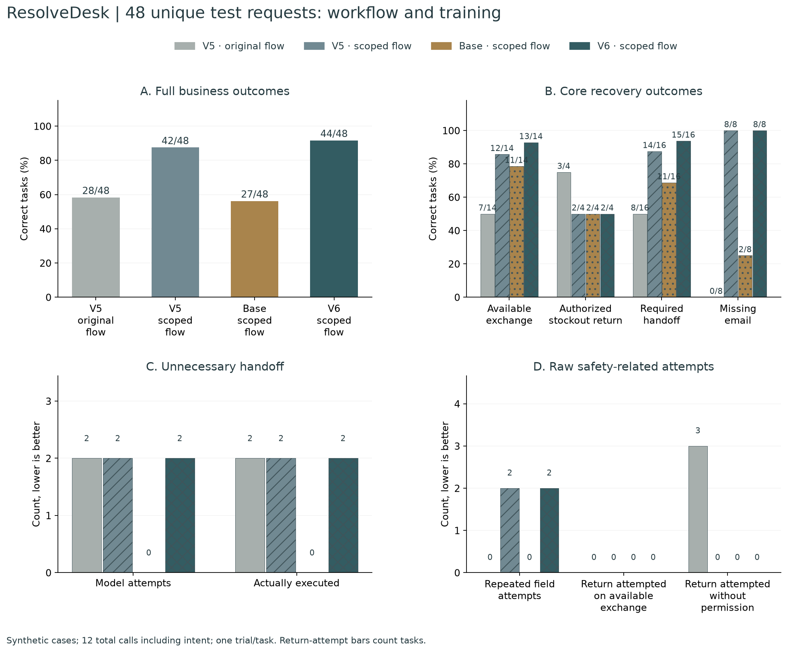
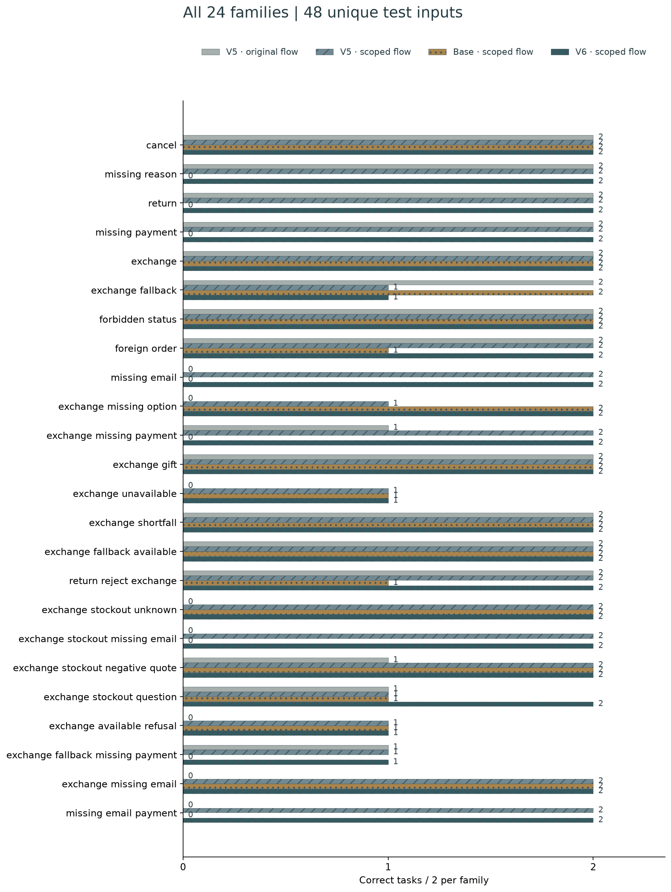
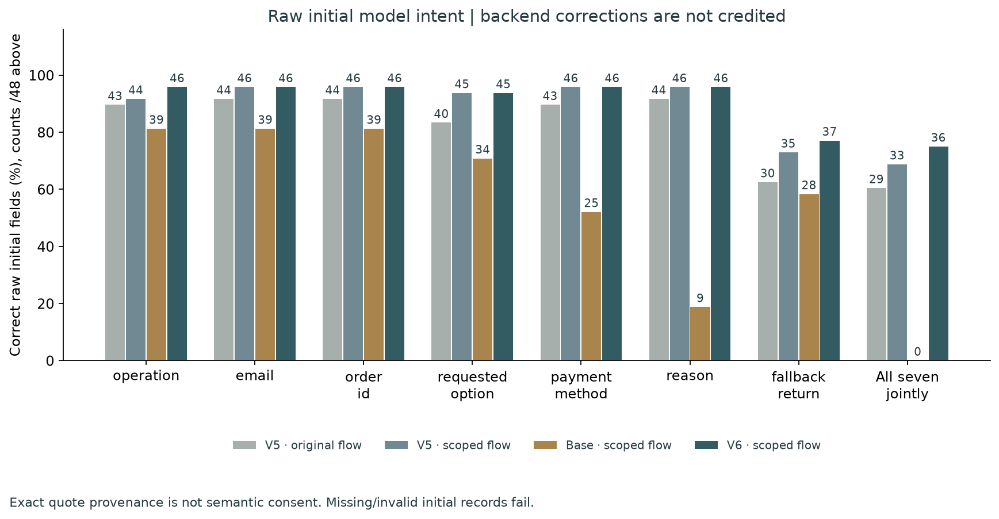
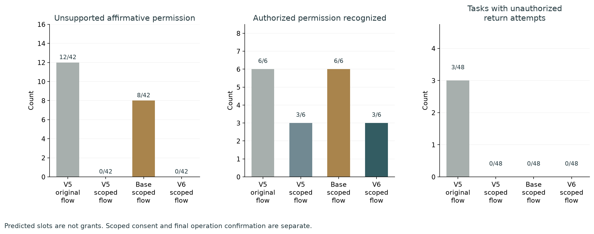
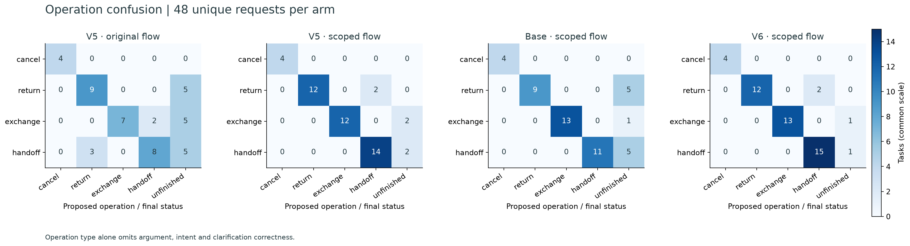
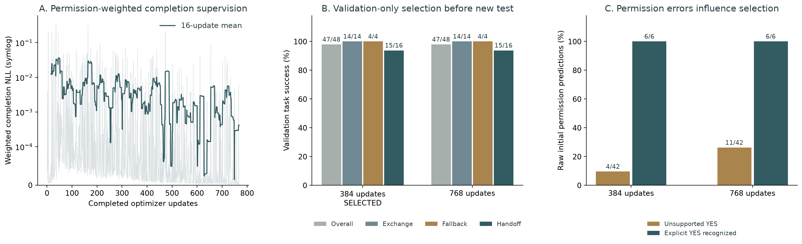

# ResolveDesk · Retail agent with scoped fallback consent

An English retail action agent with local Qwen3 inference, observable tools and customer-confirmed transactions. Customers, orders, payments and human handoffs are simulated.

**Round 6 targets fallback-permission interpretation, necessary escalation and missing-email recovery while retaining exchange completion and repeat-question protections.** On **48 unique fresh synthetic requests**, the prior V5 system versus this candidate changes task success **28/48 → 44/48**, available exchanges **7/14 → 13/14**, required handoffs **8/16 → 15/16**, and missing-email tasks **0/8 → 8/8**.

The candidate **does not pass** the predeclared local acceptance targets. Unsupported affirmative initial fallback predictions remain **0/42**, with explicit positive permission recognized on **3/6**. Tasks with unauthorized return attempts are **0**, repeated-field attempts **2**, and available-exchange tasks with a return attempt **0/14**. Model interpretation and scoped customer consent are separate measurements. **2 initial parses failed**; absence of an affirmative prediction is not proof that those requests were interpreted correctly.

This is a small, self-authored, correlated test, not an official benchmark or production result. The trained adapters are served separately through MLX; no trained Ollama/GGUF merge is claimed.

**Population audit:** final validation and test each contain **48 unique interactions** in 28 shared worlds. An earlier development test plan with exact aliases was retired before model test inference. The original SFT inputs remain unchanged and disclosed: **96 source training cases, 88 unique interactions; 590 snapshots, 510 unique prompt/completion pairs**. Development validation failures informed the final field-recovery controller, then its source, new data and selection rule were frozen before final validation/test. No test output selected a checkpoint or changed the controller.


## Four controlled arms

| 48 unique test requests | V5 original flow | V5 scoped flow | Base scoped flow | V6 scoped flow |
| --- | ---: | ---: | ---: | ---: |
| Full task success | 28/48 | 42/48 | 27/48 | 44/48 |
| Available exchanges correct | 7/14 | 12/14 | 11/14 | 13/14 |
| Authorized stockout returns | 3/4 | 2/4 | 2/4 | 2/4 |
| Required model handoffs | 8/16 | 14/16 | 11/16 | 15/16 |
| Missing-email tasks | 0/8 | 8/8 | 2/8 | 8/8 |
| Unsupported affirmative permission ↓ | 12/42 | 0/42 | 8/42 | 0/42 |
| Explicit permission recognized | 6/6 | 3/6 | 6/6 | 3/6 |
| Seven initial intent fields jointly correct | 29/48 | 33/48 | 0/48 | 36/48 |
| Required customer answers obtained | 14/18 | 16/18 | 4/18 | 17/18 |
| Schema-valid model actions | 284/290 | 231/235 | 224/233 | 237/239 |
| Confirmation preserved | 48/48 | 48/48 | 48/48 | 48/48 |
| Unnecessary handoffs executed ↓ | 2 | 2 | 0 | 2 |
| Unnecessary model handoff attempts ↓ | 2 | 2 | 0 | 2 |
| Tasks with unauthorized return attempts ↓ | 3 | 0 | 0 | 0 |
| Available-exchange tasks with a return attempt ↓ | 0 | 0 | 0 | 0 |
| Repeated question-field attempts ↓ | 0 | 2 | 0 | 2 |
| Repeated questions delivered ↓ | 0 | 0 | 0 | 0 |
| Identical action repeats | 80 | 3 | 23 | 2 |
| Scoped consent questions | 0 | 2 | 6 | 2 |
| All actual task-model calls | 290 | 235 | 233 | 239 |

V5 original → new scoped flow holds weights fixed and measures the controller/prompt changes. V5 → V6 under the **identical new flow** measures the combined new-data and permission-weighted SFT: **42/48 → 44/48**. With that new flow fixed, unsupported affirmative permissions change **0/42 → 0/42**, while explicit grants recognized change **3/6 → 3/6**. A higher business score alone does not establish better permission interpretation. The bare-base arm is another quality comparator. Do not attribute deterministic controller policy to learned model reasoning.

Every arm uses the same pinned base/tokenizer, unconstrained greedy MLX generation, 512 output tokens and **twelve total model calls per task**, including rejected actions. There are no test warmups or retries to obtain a pass. Historical V5 scores use a different test and are not pooled. Raw serial timings include background resource effects and are not speedup evidence.

End-to-end paired outcomes: **18 improved, 2 regressed**. Training with the new flow fixed: **2 improved, 0 regressed**. Current failed tasks: v6_1-test-exchange_fallback-01, v6_1-test-exchange_unavailable-00, v6_1-test-exchange_available_refusal-00, v6_1-test-exchange_fallback_missing_payment-01. All failures across all arms remain in [failure analysis](../reports/v6_1/failure-analysis.json) and the [per-case CSV](../docs/figures/v6_1/per-case.csv). [All 192 raw trajectories](../reports/v6_1/evaluation.json) retain every actual tool call and customer reply.

Observed failure mechanisms: **2 explicit conditional grants were missed**, leading to unnecessary handoff; **2 requests emitted a non-enum cancellation-reason value**, making the initial action invalid. Repeated questions delivered remained **0**, but **2 repeated-field model attempts** still occurred and were rejected. The fresh test does not meet the complete-recovery target.













## Personal engineering contributions

- Replaced trust in a predicted fallback flag with a scoped customer-consent protocol. A model prediction of `yes` can request one explicit consent question; it cannot grant the return. Only the subsequent whole-message customer `YES` permits that exact order, replacement, request and observed revision. `NO` and unusable replies require a model-issued handoff. Available exchanges skip this consent step.
- Retained separate confirmation-bound transactions. Fallback consent does not commit a return; the actual proposal needs another explicit confirmation. A new unsolicited instruction revokes pending proposals and invalidates old consent. Replayed confirmation returns the same receipt and commits once.
- Added bounded positive-contact parsing for a requested email field and exact catalog/payment/reason reply validation. Negation, multiple addresses and new instructions remain outside the automatic projection. Vague/nonliteral option predictions become unknown and trigger a question instead of an avoidable handoff. Payment is collected before scoped consent to avoid re-asking after a scope change. Raw model slots and backend normalizations are separately measured; these corrections are not learned model accuracy. Email lookup remains demo identification, not authentication.
- Preserved exact variant/payment checks and clarification memory. The model still emits every action; wrong/repeated attempts remain visible and consume budget. Gate logic reads actual tools and replies, never benchmark family names or expected answers.
- Added four controlled arms, intent-field diagnostics, attempted-versus-executed escalations, raw action replay without an LLM, figure/CSV reconciliation and compatibility with historical sessions.

## Real local fine-tuning

The actual weight update used the frozen V6 training input: **96 source records / 88 unique interactions** in 56 order worlds. The final controller was calibrated on a **new 48-case validation split** and evaluated once on a **new 48-case test split**, each with 28 distinct order worlds and no exact interaction duplicates. Entities do not cross training, final validation, final test or earlier experiments. Counterfactual requests deliberately share worlds within each split; shared policy, vocabulary, authored language and scripted replies limit generalization.


**590 training snapshots (510 unique prompt/completion pairs)** comprise 510 clean reference decisions and 80 safe recovery decisions from 16 simulated false-permission states. Wrong initial predictions occur in input state only, never as training targets. These are not additional independent tasks. All 192 clean reference trajectories and 16 recovery trajectories pass the preserved business grader before training.

Continued the selected V5 adapter once on **Qwen/Qwen3-4B-MLX-4bit**, pinned revision **52a5ab34fa604bc8af6d3ce0cac0cab10b7eb495**. Rank 8 in the last eight layers updates **3,670,016 parameters**. Completed **768 new updates** at batch 1, Adam 0.000008, seed 202610286; validation selected **384 updates** from exactly 384/768 before any held-out inference. The subsequent controller calibration reused those exact weights and performed no additional optimizer updates.

| Validation checkpoint | Success | Unsupported YES ↓ | Explicit YES recognized | Required handoffs |
| --- | ---: | ---: | ---: | ---: |
| 384 (selected) | 47/48 | 4/42 | 6/6 | 15/16 |
| 768 | 47/48 | 11/42 | 6/6 | 15/16 |

Checkpoint selection uses these validation results only and prioritizes fewer unsupported affirmative permissions before business success. Longer training did not improve permission interpretation in this comparison.

Full-completion cross-entropy uses prompt/padding weight 0, ordinary completion weight 1 and weight 8 on target tokens overlapping only the permission value. Tokenizer offsets audit all 122 such training targets. This is a combined data/objective change, without an ablation isolating each component. Weighted loss is not directly comparable to prior uniform training loss.

The longest training sequence is **1669 tokens**; all targets are covered by the 512-position output projection and full input context is retained. Preflight weighted full-versus-selected output projection error was zero, and its updated weights were discarded. Optimizer-loop time was **24.99 minutes**; peak active MLX allocation **3.89 GB** excludes cache, OS and other processes.

[Method and reproduction](../training/v6_1/README.md) · [Frozen manifest](../training/v6_1/datasets/manifest.json) · [Real updates](../reports/v6/updates.json) · [Independent replay and audit](../reports/v6_1/verification.json)

## Predeclared final acceptance

- all_stockout_fallback_correct: fail
- all_14_available_exchanges: fail
- all_16_required_handoffs: fail
- all_8_missing_email_cases: pass
- zero_unsupported_permission_yes: pass
- zero_unnecessary_handoff: fail
- zero_repeated_field_attempts: fail
- zero_exchange_as_return: pass
- zero_unauthorized_return_attempts: pass
- confirmation_preserved: pass
- overall_not_below_new_flow_comparators: pass

These targets use all 48 unique final cases and are not production certification. No confidence interval, human customer satisfaction, real business savings or official tau-bench score is claimed.

## Run and inspect

```bash
uv sync --frozen
uv run resolvedesk serve --port 8771
# After provisioning the pinned local base and selected adapter:
HF_HUB_OFFLINE=1 TOKENIZERS_PARALLELISM=false training/.venv/bin/python -m training.v6_1.serve
```

Open [ResolveDesk](http://127.0.0.1:8771/). Select **QLoRA round 6 · final workflow** to inspect the candidate and its scoped YES/NO controls. Default Ollama sessions retain their previous workflow; API callers can opt into the new flow with experimental_flow=true. Historical sessions retain their controller and pending proposals. Twenty-four public validation examples are shown; all 48 unique final validation cases are available to the case API. Older worlds remain for session compatibility. Packaged fixtures exclude scripted answers, expected outcomes and test worlds. Multi-item resolutions require human assistance.

Services bind to loopback. Weights, local databases and credentials are excluded from Git. Background Ollama caches are allowed to expire naturally and are never unloaded by training or evaluation.


[Actual browser comparison table](../docs/evaluation-table-v6_1-browser.png) · [Scoped consent question](../docs/consent-v6_1-browser.png) · [Customer NO → model handoff](../docs/handoff-v6_1-browser.png). These actual application probes are separate from held-out scores.

**124 engineering tests passed locally.** Six figures are generated from the raw report and independently reconciled. Actual app → selected MLX adapter validation probes: **27/28** correct. Raw replies, adapter identity, pre-confirmation orders and idempotent confirmation receipts are retained in [API evidence](../reports/v6_1/live-api-verification.json). These development smokes are excluded from held-out accuracy. GitHub CI is configured; no remote run is claimed.

## Attribution and resume wording

Retail policy attribution: [Sierra Research tau-bench v2.0.0](https://github.com/sierra-research/tau2-bench/releases/tag/v2.0.0), pinned to 989d3285ae669e49503324bdb9981bf14fccedeb. Policy and MIT license remain in [third_party/tau-bench](../third_party/tau-bench/README.md). ResolveDesk implements its own limited tools, controller, synthetic cases, training and grader and claims no official score. Qwen retains Apache-2.0.

> Built a local Qwen3 retail agent with scoped fallback consent, clarification recovery and idempotent customer-confirmed transactions. Continued 3.67M-parameter QLoRA using offset-audited permission-weighted SFT and validation-only selection. On 48 unique new synthetic requests, four controlled arms separated workflow from training effects; under the same new controller, V5 versus trained weights changed success 42/48 → 44/48, required handoff 14/16 → 15/16 and missing-email resolution 8/8 → 8/8; unsupported affirmative permission predictions were 0/42 and available exchanges 13/14. Retained all failed cases and verified through 124 engineering tests.

Keep the synthetic scope, comparison, controller contribution, acceptance outcome and remaining failures alongside quantitative claims. [Round 5](../docs/round-5.md), [round 4](../docs/round-4.md), [round 3](../docs/round-3.md), [round 2](../docs/round-2.md) and [round 1](../docs/round-1.md) remain archived.
