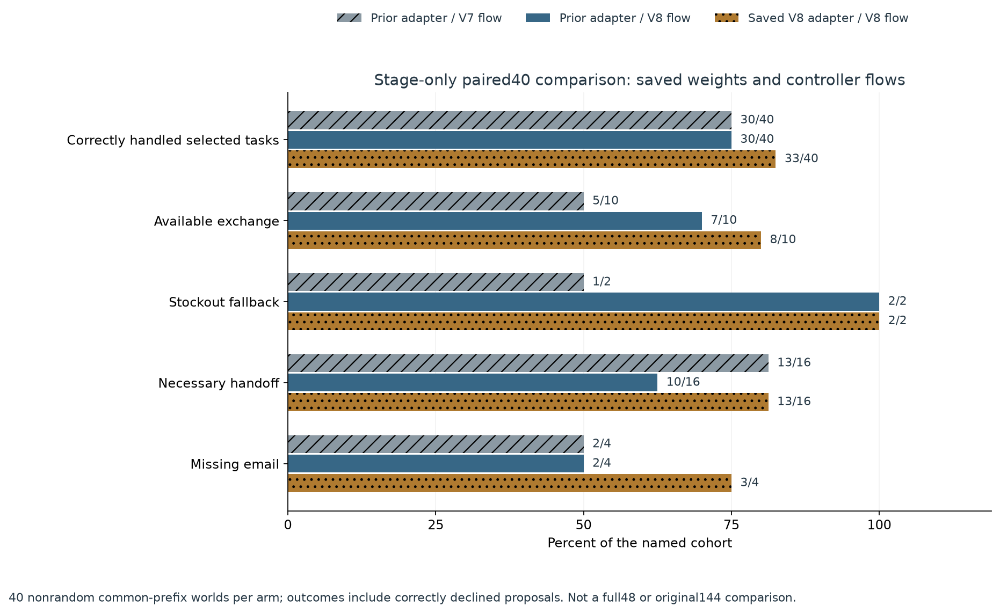
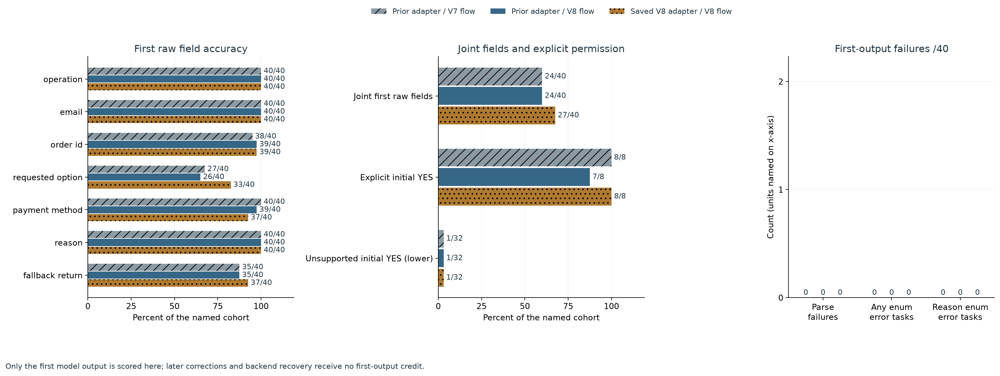
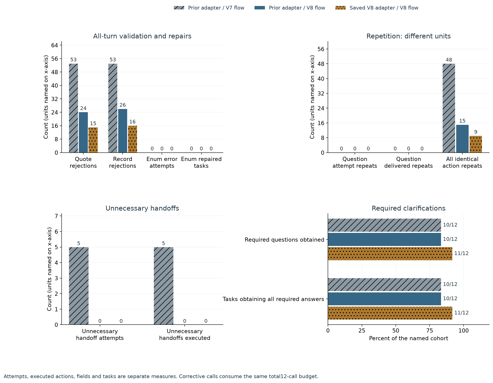
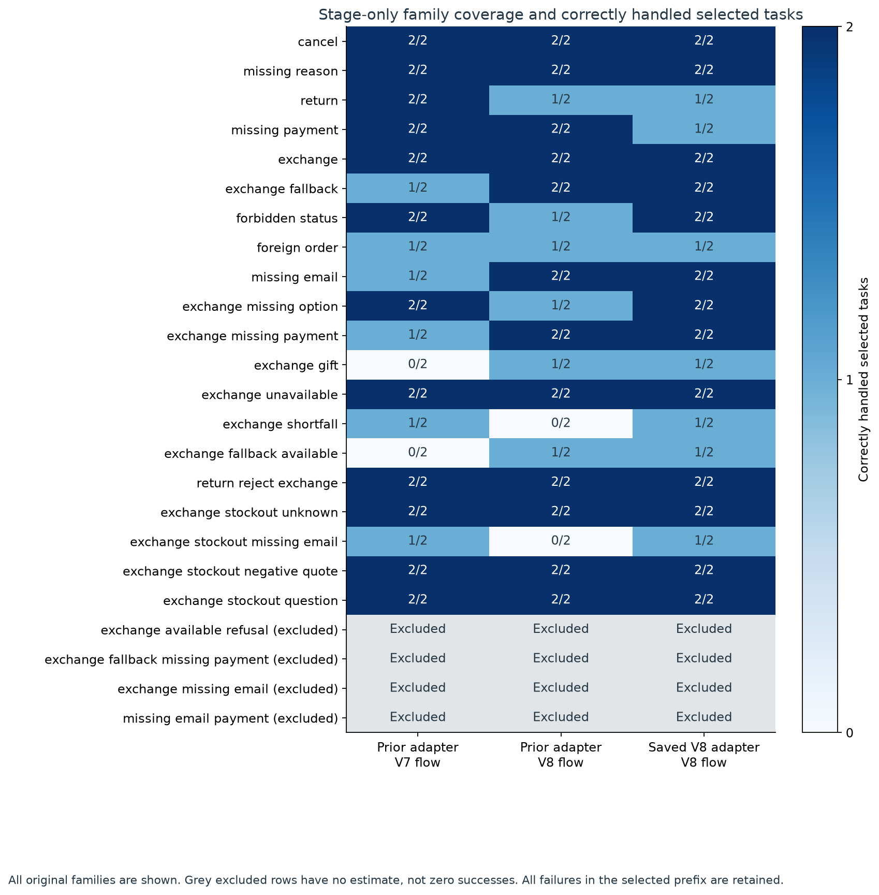
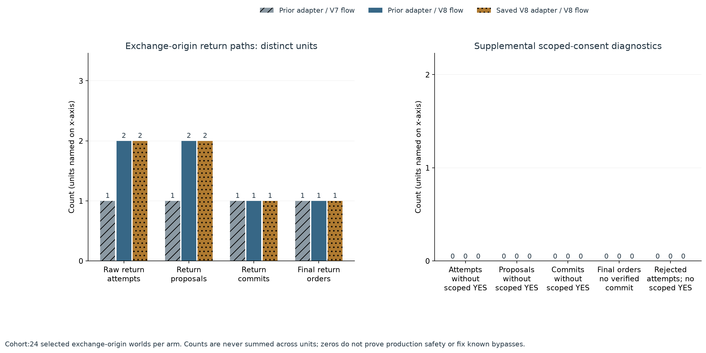
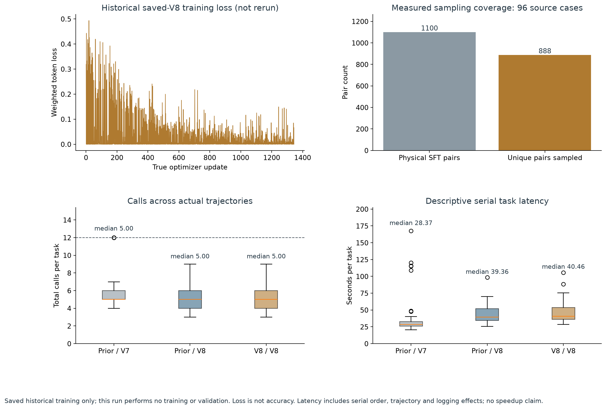

# ResolveDesk: 共同40样本中固定 V8 流程下任务正确处理增加

> **公开版范围：** 本页及图表是已核验结果的公开数值投影。新原始模型输出、提示词、token、云快照、权重和账户授权资料保留在本地。公开检查核对 CSV、分母、配对结果和图表哈希；不能复现原始 token/业务重放，也不继承本地完整封存。

这是用户明确授权后的**另行回顾性阶段分析**：固定顺序共同前 40 个场景 × 3 臂，共 120 条完整轨迹、657 次调用。原计划 144 条仍未完整、终止摘要和完整门槛保持不变；本报告不是完整48场景评测，也没有补跑模型。旧对照权重此前已经微调。

独立CPU核验覆盖全部136条完整记录、765次已保留返回及1次未知调用的请求；下面的效果指标只使用共同子集120条轨迹，另16条完整尾部记录不参与对照。

业务正确处理包含客户确认或拒绝；正确拒绝后订单应保持原状。因此换货/回退子集的成功数不等于实际换货/退款执行数。

| 指标 | 旧权重/V7 | 旧权重/V8 | 保存V8权重/V8 |
| --- | --- | --- | --- |
| 正确处理任务（含正确拒绝） | 30/40 (75.0%) | 30/40 (75.0%) | 33/40 (82.5%) |
| 可满足换货子集 | 5/10 (50.0%) | 7/10 (70.0%) | 8/10 (80.0%) |
| 缺货回退子集 | 1/2 (50.0%) | 2/2 (100.0%) | 2/2 (100.0%) |
| 必要转人工 | 13/16 (81.2%) | 10/16 (62.5%) | 13/16 (81.2%) |
| 补邮箱子集 | 2/4 (50.0%) | 2/4 (50.0%) | 3/4 (75.0%) |
| 首次七字段全部正确 | 24/40 (60.0%) | 24/40 (60.0%) | 27/40 (67.5%) |
| 首次明确授权识别 | 8/8 (100.0%) | 7/8 (87.5%) | 8/8 (100.0%) |
| 首次未获授权却预测YES ↓ | 1/32 (3.1%) | 1/32 (3.1%) | 1/32 (3.1%) |
| 首次解析失败 ↓ | 0/40 (0.0%) | 0/40 (0.0%) | 0/40 (0.0%) |
| 首次 reason 枚举错误 ↓ | 0/40 (0.0%) | 0/40 (0.0%) | 0/40 (0.0%) |
| 重复追问尝试 | 0 | 0 | 0 |
| 重复问题实际送达 | 0 | 0 | 0 |
| 所有相同动作重复 | 48 | 15 | 9 |
| 不必要转人工尝试 | 5 | 0 | 0 |
| 不必要转人工执行 | 5 | 0 | 0 |
| 模型调用 | 236 | 208 | 213 |

workflow 对照固定旧权重，仅比较 V7→V8 控制器和提示流程；training_under_v8 固定 V8 流程，比较旧权重与已保存的 V8 续训权重。combined 同时改变两者。这不能隔离某一项训练数据、采样或损失设计的贡献，也不是原始 Qwen 对比微调模型。

| Contrast | Both pass | Both fail | Improved | Regressed |
| --- | --- | --- | --- | --- |
| workflow | 25 | 5 | 5 | 5 |
| training_under_v8 | 28 | 5 | 5 | 2 |
| combined | 27 | 4 | 6 | 3 |

关键条件的覆盖数量（不是正确率）：

| Condition | Included40 | Original48 |
| --- | --- | --- |
| natural_initial_literal_quote_provenance | 40 | 48 |
| missing_payment | 4 | 8 |
| stockout_return_fallback_with_missing_payment | 0 | 2 |
| available_exchange_with_missing_email | 0 | 2 |
| two_missing_email_and_payment_fields | 0 | 2 |
| available_exchange_explicit_return_refusal | 0 | 2 |
| ambiguous_option_needs_customer_choice | 2 | 2 |
| initial_known_option_exchange | 22 | 28 |
| quoted_permission_hard_negative | 2 | 2 |
| necessary_handoff_gold_cases | 16 | 16 |
| gold_non_handoff_cases | 24 | 32 |

未覆盖分支（不计零分）：

| Family | Included / original | Interpretation |
| --- | --- | --- |
| exchange_available_refusal | 0/2 | 可满足换货中明确拒绝回退的两条分支样例未纳入，不能由其它 NO 识别率推断此分支已改善。 |
| exchange_fallback_missing_payment | 0/2 | 缺货回退时缺支付方式的澄清与恢复未覆盖，不能声称已解决该回退失败。 |
| exchange_missing_email | 0/2 | 可满足换货时补邮箱及后续保持换货意图的专门分支未覆盖。 |
| missing_email_payment | 0/2 | 邮箱和支付方式双缺失的多轮恢复分支未覆盖。 |

共同前40由固定臂块顺序和截止时间产生，并非随机截断或新的独立 benchmark。原完整记录为48/48/40，另16条旧权重臂尾部完整记录被排除；7个新权重任务未启动，1个任务有一次已发出但返回状态不明的调用。缺失8条不计成功或失败，不自动重放或续接。不能把此子集的比例外推到原48，更不能推断未覆盖的V8改进分支有效。

类别构成也已偏移：必要转人工16条全部纳入，占16/40，而原为16/48；缺失8条全属非转人工，非转人工覆盖从32条降为24条。三组40内部仍可按同场景配对描述，但不能把总体率直接与原48或历史96条评测的总体率比较。

引文纠正、商品尾缀/规格匹配和 original order 与支付方式的区分，也不是单独随机化专项对照；只能结合已选轨迹讨论，不能从整体业务率声称所有这些修复均有效。

首次字段只取第一个原始输出，后续修复不补首次正确率。未获授权却预测YES不是实际未授权交易。重复追问尝试、实际送达与所有动作重复分列；所有失败和纠正调用均计入每任务12次上限。同作者零售合成场景、有限目录和脚本回复限制泛化；串行延迟包含固定臂顺序、轨迹与日志开销，不构成孤立硬件速度对照。零观察的 scoped-consent 违规不证明生产安全。

以下均为已选初始换货场景，单位不得相加：

| 指标 | 旧权重/V7 | 旧权重/V8 | 保存V8权重/V8 |
| --- | --- | --- | --- |
| Exchange-origin tasks | 24 | 24 | 24 |
| Raw return attempts | 1 | 2 | 2 |
| Return proposals | 1 | 2 | 2 |
| Return commits | 1 | 1 | 1 |
| Final return orders | 1 | 1 | 1 |
| Attempts without scoped YES | 0 | 0 | 0 |
| Proposals without scoped YES | 0 | 0 | 0 |
| Commits without scoped YES | 0 | 0 | 0 |
| Final orders without verified commit | 0 | 0 | 0 |
| Rejected attempts without scoped YES | 0 | 0 | 0 |

历史保存的 V8 训练完成1344更新，实际采样888/1100条物理训练pair、96个源场景。rank8、112个FP32张量、3,670,016参数。本轮新增更新为0；历史训练损失不是本轮新增训练或准确率。

所选120条内全部失败记录：

| Arm | Case | Final status | Calls |
| --- | --- | --- | --- |
| prior_weights_old_flow | v8-eval2-test-exchange_fallback-01 | handoff | 6 |
| prior_weights_old_flow | v8-eval2-test-foreign_order-01 | running | 12 |
| prior_weights_old_flow | v8-eval2-test-missing_email-01 | running | 12 |
| prior_weights_old_flow | v8-eval2-test-exchange_missing_payment-01 | handoff | 5 |
| prior_weights_old_flow | v8-eval2-test-exchange_gift-00 | handoff | 5 |
| prior_weights_old_flow | v8-eval2-test-exchange_gift-01 | handoff | 6 |
| prior_weights_old_flow | v8-eval2-test-exchange_shortfall-00 | running | 12 |
| prior_weights_old_flow | v8-eval2-test-exchange_fallback_available-00 | handoff | 5 |
| prior_weights_old_flow | v8-eval2-test-exchange_fallback_available-01 | running | 12 |
| prior_weights_old_flow | v8-eval2-test-exchange_stockout_missing_email-00 | running | 12 |
| prior_weights_new_flow | v8-eval2-test-return-01 | failed | 6 |
| prior_weights_new_flow | v8-eval2-test-forbidden_status-00 | failed | 3 |
| prior_weights_new_flow | v8-eval2-test-foreign_order-01 | failed | 6 |
| prior_weights_new_flow | v8-eval2-test-exchange_missing_option-00 | failed | 3 |
| prior_weights_new_flow | v8-eval2-test-exchange_gift-00 | failed | 3 |
| prior_weights_new_flow | v8-eval2-test-exchange_shortfall-00 | failed | 3 |
| prior_weights_new_flow | v8-eval2-test-exchange_shortfall-01 | failed | 3 |
| prior_weights_new_flow | v8-eval2-test-exchange_fallback_available-01 | failed | 3 |
| prior_weights_new_flow | v8-eval2-test-exchange_stockout_missing_email-00 | failed | 3 |
| prior_weights_new_flow | v8-eval2-test-exchange_stockout_missing_email-01 | failed | 9 |
| v8_weights_new_flow | v8-eval2-test-return-01 | failed | 6 |
| v8_weights_new_flow | v8-eval2-test-missing_payment-00 | failed | 6 |
| v8_weights_new_flow | v8-eval2-test-foreign_order-01 | failed | 6 |
| v8_weights_new_flow | v8-eval2-test-exchange_gift-01 | failed | 3 |
| v8_weights_new_flow | v8-eval2-test-exchange_shortfall-00 | failed | 3 |
| v8_weights_new_flow | v8-eval2-test-exchange_fallback_available-01 | failed | 3 |
| v8_weights_new_flow | v8-eval2-test-exchange_stockout_missing_email-01 | failed | 9 |

[CSV120](figures/v8-eval2-partial40/per-case.csv) · [Paired40](figures/v8-eval2-partial40/case-mapping.csv) · [Metric denominators](figures/v8-eval2-partial40/metrics.csv) · [Historical training](figures/v8-eval2-partial40/training.csv)

[Public result and local-verification summary](../reports/v8-eval2-partial40/public-summary.json) · [120 public case rows](figures/v8-eval2-partial40/per-case.csv) · [Published scope](../PUBLICATION_STATUS.md) · [Chart values and public hashes](figures/v8-eval2-partial40/values.json) · [Failure analysis](v8-eval2-partial40-failure-analysis.zh-CN.md)
